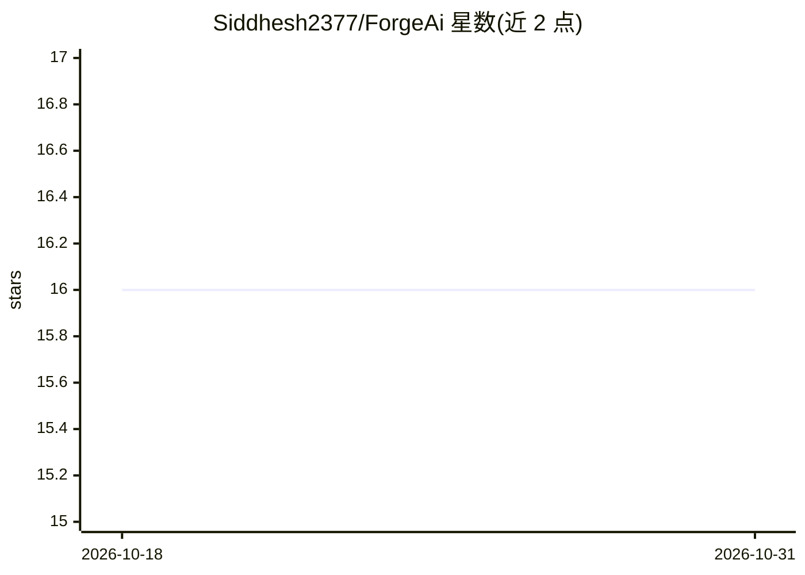

# Siddhesh2377/ForgeAi

⭐ 16 · Rust · MIT · 推送 2026-02-10 · [GitHub](https://github.com/Siddhesh2377/ForgeAi) · [官网](https://forge-64364c0e.mintlify.app/getting-started/introduction) · 个人维护

**本地离线的模型工作台桌面应用：加载、检查、量化、微调、合并**

基于 Tauri v2、SvelteKit 5 与 Rust 构建的本地优先桌面应用，面向需要在本地管理 AI 模型的开发者。功能划分为 11 个模块：加载 GGUF/SafeTensors 模型、3D 架构与内存分布检查、SHA-256 校验、GGUF 七级量化（底层调用 llama.cpp）、HuggingFace 模型搜索下载、SafeTensors 转 GGUF、LoRA/QLoRA/SFT/DPO 微调与层手术、12 种模型合并方法及推理测试。完全离线运行，无云端与遥测。限制：量化依赖 llama.cpp 自动下载，转换依赖独立 Python 环境，微调按预设需 4–24 GB VRAM。

## 筛选速览

| 维度 | 判定 | 备注 |
|---|---|---|
| AI 角色 | `ai-ecosystem` | LLM/agent 周边工具 |
| 许可风险 | `permissive` | MIT |
| 部署形态 | `None` |  |
| 模型依赖 | local-ok | 支持本地模型 |
| 硬件要求 | `cpu-ok` | |
| 安装摩擦 | `medium` | 含编译或系统依赖之一 |
| 成熟度 | — | 结构信号不足 |

## 能力要点

- 12 种模型合并方法（SLERP/TIES/DARE/Frankenmerge/MoE 转换等）
- GGUF 七级量化，底层调用 llama.cpp
- LoRA/QLoRA/SFT/DPO 微调，支持按能力定向选层
- 8 种推理运行时兼容性检查与 SHA-256 指纹

## 适用场景

- 在本地离线完成模型下载、检查与量化压缩
- 微调或合并模型并验证运行时兼容性
- 在不联网的机器上管理本地模型库

## 场景标签

`微调` `模型量化` · 领域:训练与推理

## 证据(README 行号)

> L21: ForgeAI is a **local-first desktop application** for working with AI models — from downloading and inspecting to fi
> L5:  Your local AI model workshop — load, inspect, compress, train, merge, and test models entirely offline.

## 星数曲线

2026-10-18 16 → 2026-10-31 16（+0）

---
*卡片 v1 · prompt 1.4 · 生成 2026-10-30 · 置信度 high · 依据 README sha `40caa10b253e` · [字段定义](../../DATASET.md)*
