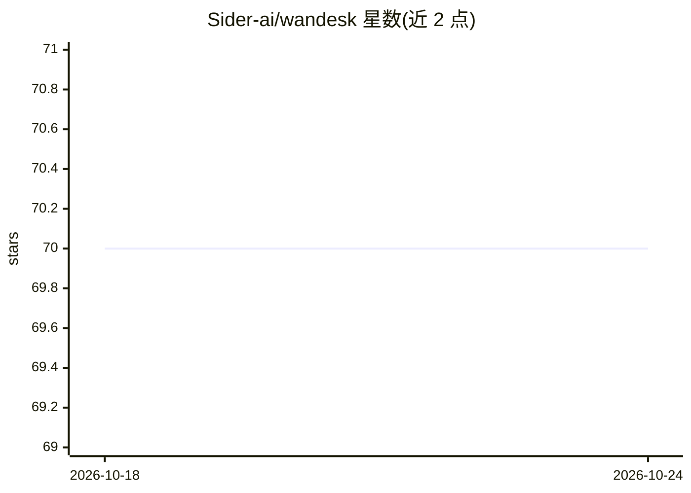

# Sider-ai/wandesk

⭐ 70 · TypeScript · ISC · 推送 2026-10-13 · [GitHub](https://github.com/Sider-ai/wandesk) · [官网](https://wandesk.ai) · 组织维护 · 中文 README

**开源 AI 桌面：内置 agent 按描述生成 Worker 应用**

本地优先的 AI 桌面环境：用户用自然语言描述应用，内置 agent 直接将其写入工作区并以图标形式出现在桌面。每个应用是标准 Cloudflare Worker 站点，拥有独立 origin 与 SQLite 数据库；应用通过 env.AI 共享同一个知晓全局的 agent。支持任何 Responses 或 Chat-Completions 兼容端点，无需注册。以 Node.js 22+ 源码运行，提供 Electron 桌面壳与 macOS/Windows 打包构建；限制：agent 拥有未沙箱化的 shell，workerd 约 150MB 随发布包内置。

## 筛选速览

| 维度 | 判定 | 备注 |
|---|---|---|
| AI 角色 | `ai-native` | 本体是模型或模型工具 |
| 许可风险 | `permissive` | ISC |
| 部署形态 | `desktop` | 安装包/桌面程序 |
| 模型依赖 | — | README 未给出锁定关系 |
| 硬件要求 | — | 无带数字的原话,不猜 |
| 安装摩擦 | `low` | 无编译、无系统依赖或容器化 |
| 成熟度 | — | 结构信号不足 |

## 能力要点

- 内置 agent 将自然语言描述写入为 Worker 站点应用，即装即用
- 每个应用独立 origin 与 SQLite，数据相互隔离
- 应用通过 env.AI 统一调用共享 agent，上下文与工具汇聚于内核
- 本地优先，支持任意 Responses/Chat-Completions 兼容端点

## 适用场景

- 用对话让 AI 当场为我写一个桌面小工具
- 在本地运行一个可让 AI 持续扩展应用集合的桌面环境
- 编辑、删除预装应用以定制自己的工作区

## 场景标签

 · 领域:桌面操作系统/AI 应用平台

## 证据(README 行号)

> L5: An open-source AI desktop. Describe an app and the built-in agent writes it into your workspace; the desktop grows a
> L79: return env.AI.stream({ summary: "Assistant: answer the user", prompt: text });

## 星数曲线

2026-10-18 70 → 2026-10-24 70（+0）

---
*卡片 v1 · prompt 1.4 · 生成 2026-10-24 · 置信度 mid · 依据 README sha `e68daf650635` · [字段定义](../../DATASET.md)*
