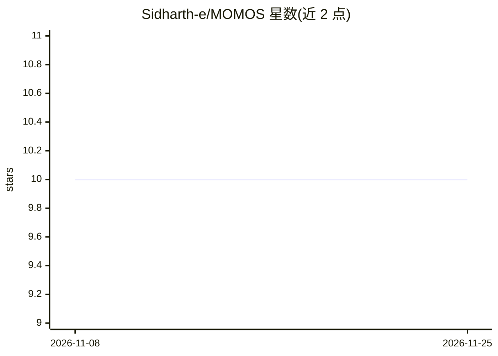

# Sidharth-e/MOMOS

⭐ 10 · Shell · MIT · 推送 2026-10-02 · [GitHub](https://github.com/Sidharth-e/MOMOS) · 个人维护

**安卓手机上一条命令安装 Ollama 本地跑小型模型**

面向 Android 设备的安装脚本与 CLI（Termux 环境）：检测手机架构/RAM/存储，将 Ollama 作为原生 Termux 包安装（无需 root、无容器），按设备内存推荐并下载 <7B 模型，提供 momos 命令做聊天、模型管理与 Web UI。服务默认仅监听手机本机 127.0.0.1，--lan 才开放到 Wi-Fi；暴露 OpenAI 兼容 API。要求 Android 7.0+、64 位设备、2GB+ RAM；32 位设备走 PRoot Debian 容器的 legacy 脚本。

## 筛选速览

| 维度 | 判定 | 备注 |
|---|---|---|
| AI 角色 | `ai-ecosystem` | LLM/agent 周边工具 |
| 许可风险 | `permissive` | MIT |
| 部署形态 | `None` |  |
| 模型依赖 | local-ok | 支持本地模型 |
| 硬件要求 | — | 无带数字的原话,不猜 |
| 安装摩擦 | `low` | 无编译、无系统依赖或容器化 |
| 成熟度 | — | 结构信号不足 |

## 能力要点

- 一条 curl 命令完成硬件检测、Ollama 安装与模型下载
- 提供 momos chat/models/ui/logs 等 CLI 子命令
- 默认仅监听本机，--lan 才向 Wi-Fi 暴露并输出 OpenAI 兼容地址
- 离线 Markdown 渲染的聊天 Web UI，聊天记录存于浏览器

## 适用场景

- 在无 root 的安卓手机上离线运行 1B-7B 本地模型
- 把手机作为局域网内的 OpenAI 兼容推理端点
- 在手机浏览器或笔记本上通过 Web UI 聊天

## 场景标签

`推理引擎` · 领域:训练与推理

## 证据(README 行号)

> L9: Run lightweight AI models locally on your Android phone using Termux and Ollama. One command to install, no root nee
> L18: - Installs Ollama as a native Termux package — no container, no root
> L20: - Adds a simple `momos` command to chat, serve the web UI and manage models

## 星数曲线

2026-11-08 10 → 2026-11-25 10（+0）

---
*卡片 v1 · prompt 1.4 · 生成 2026-11-20 · 置信度 high · 依据 README sha `63421fa94c95` · [字段定义](../../DATASET.md)*
