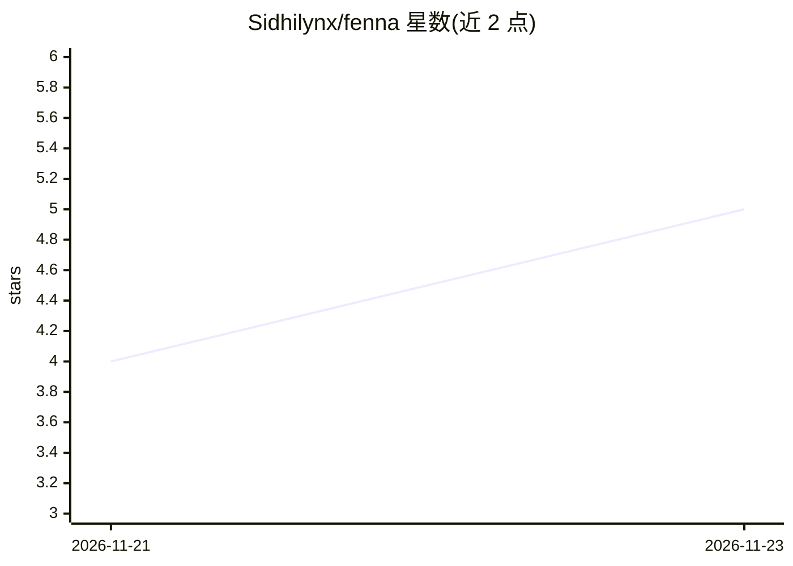

# Sidhilynx/fenna

⭐ 5 · TypeScript · AGPL-3.0 · 推送 2026-11-22 · [GitHub](https://github.com/Sidhilynx/fenna) · [官网](https://fenna.sidhilynx.com) · 组织维护

**本地运行的常驻 AI bot 工作组，用已有 AI 订阅干活**

Electron 桌面应用（v0.9），将多个常驻 bot 部署在用户本机：每个 bot 有自己的桌面环境（浏览器、文件库），按计划或消息唤醒执行任务，输出写入 Fenna 自带的 Slides/Docs/Sheets/Whiteboard/Design 编辑器，用户可随时接管。每个 crew 附带 Builder bot，可按需构建并测试应用工具。bot 运行用户已有的 Claude Code、Codex 或 Antigravity 订阅，无需账号，文件以纯文件夹形式留在本地。支持 MCP 连接器与保存的登录凭据（bot 不接触密码）。

## 筛选速览

| 维度 | 判定 | 备注 |
|---|---|---|
| AI 角色 | `ai-native` | 本体是模型或模型工具 |
| 许可风险 | `dual` | AGPL-3.0 |
| 部署形态 | `desktop` | 安装包/桌面程序 |
| 模型依赖 | — | README 未给出锁定关系 |
| 硬件要求 | — | 无带数字的原话,不猜 |
| 安装摩擦 | `low` | 无编译、无系统依赖或容器化 |
| 成熟度 | `idea` | |

## 能力要点

- bot 按计划/消息唤醒，在本地桌面（浏览器+文件库）自主工作，可随时接管
- Builder bot 可按需求构建并测试工具应用，应用以密封权限运行
- 五个文件编辑器均提供 MCP server，任何 MCP 客户端可直接操作文件
- 文件为严格文档化的 JSON+HTML 子集，支持版本防覆盖

## 适用场景

- 给 bot 安排定时任务，自动产出幻灯片、文档或表格
- 让 Builder 为特定工作流现做一个小工具或 Node 网站
- 在群聊中 @ 不同 bot 协作处理同一批本地文件

## 场景标签

`工作流自动化` `编码 Agent` · 领域:效率与自动化

## 证据(README 行号)

> L9: Give a bot a job and a schedule. It wakes on time, or when you message it,
> L27: - **Use the AI you already pay for.** Bots run Claude Code, Codex or
> L56: > Fenna is new (version 0.9). Expect rough edges, and please

## 星数曲线

2026-11-21 4 → 2026-11-23 5（+1）

---
*卡片 v1 · prompt 1.4 · 生成 2026-11-21 · 置信度 high · 依据 README sha `f787cfc7ed84` · [字段定义](../../DATASET.md)*
