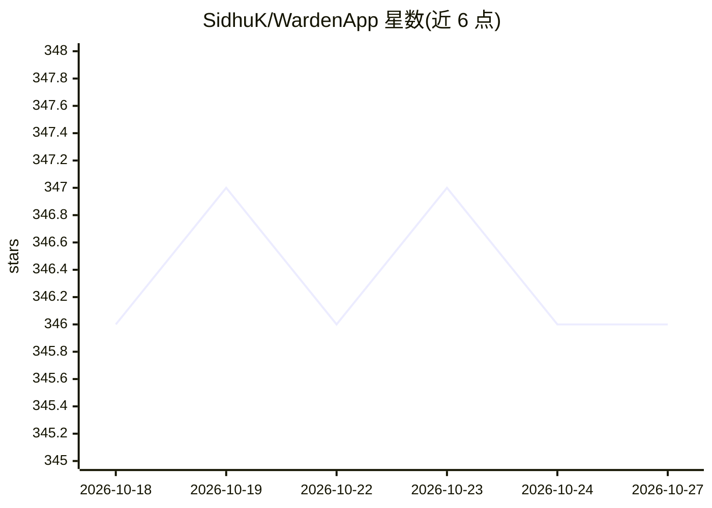

# SidhuK/WardenApp

⭐ 346 · Swift · Apache-2.0 · 推送 2026-10-21 · [GitHub](https://github.com/SidhuK/WardenApp) · [官网](https://karatsidhu.gumroad.com/l/warden) · 个人维护

**macOS 原生 AI 聊天客户端：多模型对话、本地模型与隐私优先**

用 SwiftUI 与 macOS 原生框架编写的 AI 聊天客户端，面向 Mac 用户。支持自带 API key 接入 OpenAI、Anthropic、Gemini、Perplexity、OpenRouter 等服务商，也支持 Ollama 与 LM Studio 本地模型。功能包括项目/工作区组织对话、自定义 AI 助手、文件与 PDF 对话、最多三模型对比（beta）、带引用的网页搜索、MCP agent 连接与菜单栏快捷访问。对话数据保留在本机，仅向所选 AI 服务商发送请求。通过 Homebrew cask、安装包下载或 Xcode 源码构建三种方式安装。

## 筛选速览

| 维度 | 判定 | 备注 |
|---|---|---|
| AI 角色 | `ai-native` | 本体是模型或模型工具 |
| 许可风险 | `permissive` | Apache-2.0 |
| 部署形态 | `desktop` | 安装包/桌面程序 |
| 模型依赖 | local-ok | 支持本地模型 |
| 硬件要求 | — | 无带数字的原话,不猜 |
| 安装摩擦 | `low` | 无编译、无系统依赖或容器化 |
| 成熟度 | `idea` | |

## 能力要点

- 多服务商接入（自带 API key）+ Ollama/LM Studio 本地模型
- 文件与 PDF 对话、最多三模型响应对比（beta）
- 工具与 MCP agent 按消息启用
- 对话数据保留本机，仅向所选 AI 服务商发送请求

## 适用场景

- 在 Mac 上用统一客户端对话多个 AI 模型
- 用 Ollama 等本地模型离线聊天
- 对比多个模型的回答并基于文件提问

## 场景标签

`聊天机器人` `文档问答` · 领域:对话与助手

## 证据(README 行号)

> L5:  A native, privacy-focused AI chat client for macOS.
> L24: - **Multi-model support:** OpenAI, Anthropic, Gemini, Perplexity, OpenRouter, and more with your own API key.
> L25: - **Local AI:** Ollama and LM Studio support.

## 星数曲线

2026-10-18 346 → 2026-10-27 346（+0）

---
*卡片 v1 · prompt 1.4 · 生成 2026-10-21 · 置信度 high · 依据 README sha `c31915a0e3d7` · [字段定义](../../DATASET.md)*
