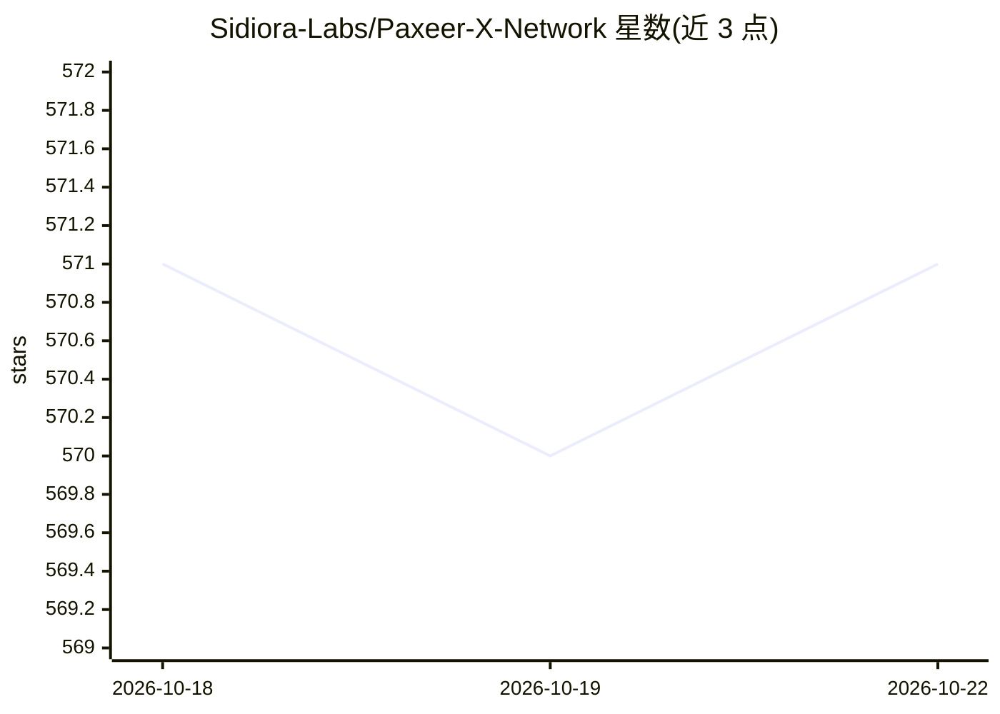

# Sidiora-Labs/Paxeer-X-Network

⭐ 571 · Go · Apache-2.0 · 推送 2026-10-21 · [GitHub](https://github.com/Sidiora-Labs/Paxeer-X-Network) · [官网](https://paxeer.network) · 组织维护

**面向自主 agent 的区块链网络：支付、代码执行与意图路由**

由 Sidiora Labs 开发的 monorepo，包含两个执行域：Go 编写的 EVM 链节点 paxd（BFT 共识，链 ID 125）与 C17 编写的 LayerX 内核 layerxd，后者对 agent 活动做确定性执行与记账并为每次活动返回签名回执。仓库收录链上合约（Foundry/Solidity）、预编译模块、链下服务（agent 守护进程、MCP 服务器、互操作网关、开发者平台）、多语言客户端 SDK（Rust/Python/TS/Go/JVM/.NET/Swift）及钱包、永续合约前端等应用。目前限量 beta 尚未开放，无通用水龙头，需从源码构建运行。

## 筛选速览

| 维度 | 判定 | 备注 |
|---|---|---|
| AI 角色 | `ai-ecosystem` | LLM/agent 周边工具 |
| 许可风险 | `permissive` | Apache-2.0 |
| 部署形态 | `None` |  |
| 模型依赖 | — | README 未给出锁定关系 |
| 硬件要求 | — | 无带数字的原话,不猜 |
| 安装摩擦 | `high` | 编译与系统依赖俱全 |
| 成熟度 | `idea` | |

## 能力要点

- paxd 链节点（Go、BFT 共识、EVM）与 layerxd 内核（C17、确定性执行与记账）双执行域
- LayerX 内核为 agent 活动返回签名回执，检查点经 layerxAnchor 预编译结算上链
- agent 守护进程与 MCP 服务器，CLI 可安装 mcp/a2a 传输（layerx install）
- 多语言客户端 SDK 与 19+ 个状态化预编译（bank/staking/layerx 系列/spot 系列等）

## 适用场景

- 构建需要在链上结算与审计的自主 agent 执行环境
- 通过 MCP 服务器将 Paxeer X 网络接入 agent 框架
- 在链上开发支付、永续合约与现货交易相关应用

## 场景标签

`Agent 框架` · 领域:Agent 开发

## 证据(README 行号)

> L5: Paxeer X Network is one network with two execution domains: the Paxeer X chain (`paxd`, Go, EVM chain ID 125) and th
> L14: - **Off-chain services.** The agent daemon and MCP server, the interop gateway and bridge relayer, the hosted devel
> L55: The agent daemon is `services/agent/crates/layerx-agentd` and the MCP server is `services/agent/crates/layerx-mcp`.

## 星数曲线

2026-10-18 571 → 2026-10-22 571（+0）

---
*卡片 v1 · prompt 1.4 · 生成 2026-10-21 · 置信度 high · 依据 README sha `1a5a4e0575a6` · [字段定义](../../DATASET.md)*
