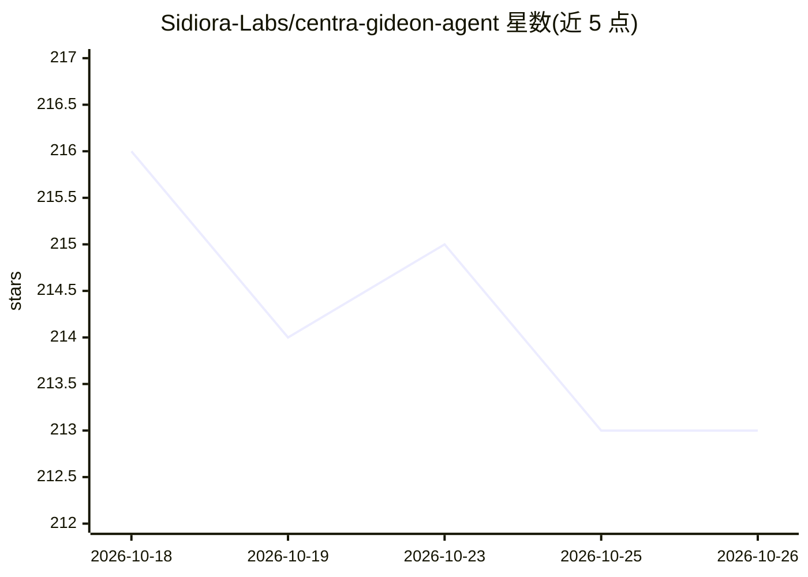

# Sidiora-Labs/centra-gideon-agent

⭐ 213 · Python · Apache-2.0 · 推送 2026-10-22 · [GitHub](https://github.com/Sidiora-Labs/centra-gideon-agent) · [官网](https://centra.ag) · 组织维护

**自托管的个人 AI agent 平台：网关+Web 控制台**

Sidiora Labs 开源的 Gideon 自托管版：一个网关加 Web 控制台，提供流式聊天、长时目标循环、分层记忆、知识库、任务/调度、收件箱与权限门控的应用平台；通过 gideon.sdk、技能、提示词与 MCP 服务器扩展能力。模型提供方可选 API、OpenAI 兼容端点、AWS Bedrock 或本地模型，核心与提供方解耦。需 Python 3.12+、macOS/Linux（Windows 走 Docker），无外部数据库或消息队列；另提供托管服务（独立发布周期）。以源码 checkout、安装脚本或单容器 Docker 方式部署。

## 筛选速览

| 维度 | 判定 | 备注 |
|---|---|---|
| AI 角色 | `ai-native` | 本体是模型或模型工具 |
| 许可风险 | `permissive` | Apache-2.0 |
| 部署形态 | `self-host` | docker 或自建部署 |
| 模型依赖 | — | README 未给出锁定关系 |
| 硬件要求 | — | 无带数字的原话,不猜 |
| 安装摩擦 | `low` | 无编译、无系统依赖或容器化 |
| 成熟度 | — | 结构信号不足 |

## 能力要点

- 流式聊天、工具调用、子 agent 与跨多轮的目标循环调度
- 分层记忆与文档知识库，回答引用用户自有材料
- 权限门控的应用平台（gideon.sdk）、技能与 MCP 服务器扩展
- 工具审批、凭证处理、命令筛查与审计轨迹

## 适用场景

- 自托管一个长期运行的个人 AI agent 处理日常任务
- 把重复请求固化为任务、触发器与工作流
- 让 agent 基于自己文档的知识库回答问题

## 场景标签

`Agent 框架` `AI 助手` `文档问答` · 领域:Agent 开发

## 证据(README 行号)

> L10: Gideon is a personal AI agent platform. This repository is its open-source, self-hosted edition: a gateway and web 
> L18: - **Talk to it, or hand work off.** Chat sessions with streaming replies, tool calls, artifacts and a transcript yo

## 星数曲线

2026-10-18 216 → 2026-10-26 213（-3）

---
*卡片 v1 · prompt 1.4 · 生成 2026-10-22 · 置信度 mid · 依据 README sha `6107731fc4f6` · [字段定义](../../DATASET.md)*
