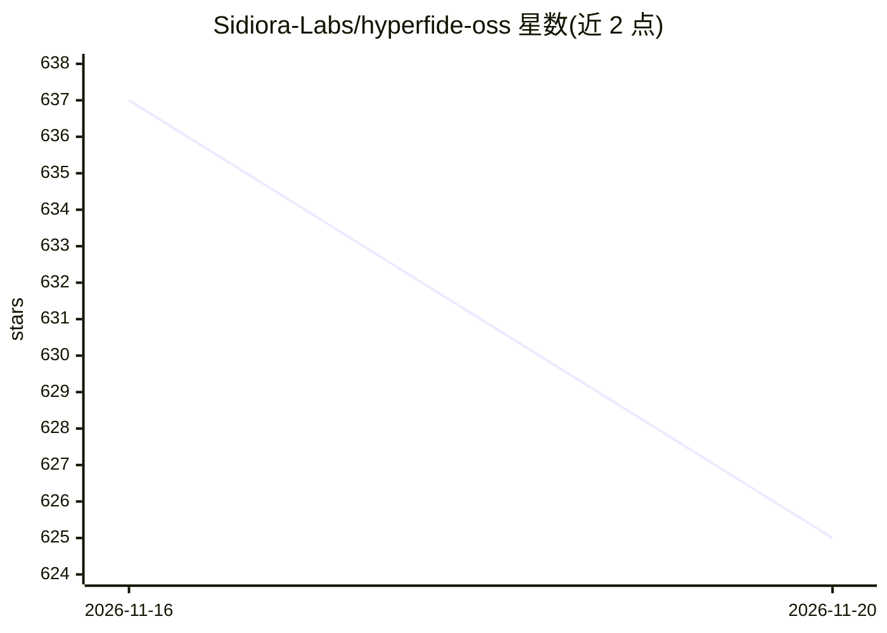

# Sidiora-Labs/hyperfide-oss

⭐ 625 · TypeScript · Apache-2.0 · 推送 2026-11-16 · [GitHub](https://github.com/Sidiora-Labs/hyperfide-oss) · [官网](https://www.hyperfide.com) · 组织维护

**单二进制 agent 工作流引擎：管理任务规划、代码图谱与记忆**

以单个二进制 hyperfide 提供的 agent 工作流引擎，维护代码图谱（符号/调用/导入，存于本地 SQLite）、内置内容寻址快照系统、kvx 规格任务板（依赖波次、验收校验）与 agent 记忆。hyperfide fleet up 启动可崩溃恢复的监督进程，驱动 Codex CLI 或 Claude Code 会话按任务并行执行、合并与拉取请求；内置 MCP 服务器暴露 71 个工具。核心循环无网络调用，遥测不发送；可选的 Jev 判定需 OPENROUTER_API_KEY。Node 22 + pnpm 运行，仓库含 apps/core/plugins 分层。

## 筛选速览

| 维度 | 判定 | 备注 |
|---|---|---|
| AI 角色 | `ai-ecosystem` | LLM/agent 周边工具 |
| 许可风险 | `permissive` | Apache-2.0 |
| 部署形态 | `library` | 以包/库形式分发 |
| 模型依赖 | — | README 未给出锁定关系 |
| 硬件要求 | — | 无带数字的原话,不猜 |
| 安装摩擦 | `medium` | 含编译或系统依赖之一 |
| 成熟度 | — | 结构信号不足 |

## 能力要点

- 源码索引为可查询代码图谱，本地 SQLite 存储
- fleet 层级驱动 Codex/Claude Code 会话并行执行任务并合并
- 内置 MCP 服务器暴露 71 个工具/资源/提示
- 核心循环零网络调用、无遥测，数据留在本机

## 适用场景

- 在大仓库上让多个 AI agent 按规格任务并行开发并自动合并
- 跨会话保留项目决策与记忆，供 agent 检索
- 核验任务完成状态是否与代码图谱和历史一致

## 场景标签

`Agent 框架` `多智能体` `Agent 记忆` `工作流自动化` · 领域:Agent 开发

## 证据(README 行号)

> L45: Hyperfide is an agent workflow engine in a single binary, `hyperfide`. It maintains the four things a project needs
> L49: `hyperfide fleet up` starts a durable, crash-resumable supervisor for the main agent, wave managers and task worker

## 星数曲线

2026-11-16 637 → 2026-11-20 625（-12）

---
*卡片 v1 · prompt 1.4 · 生成 2026-11-17 · 置信度 high · 依据 README sha `57d2cd8b1e91` · [字段定义](../../DATASET.md)*
