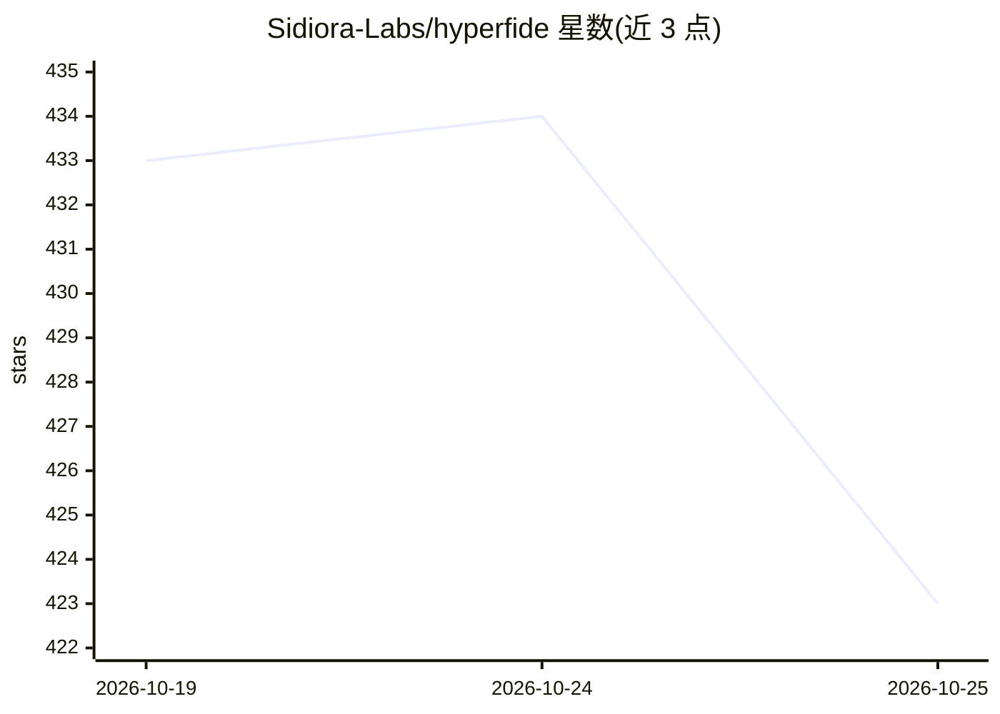

# Sidiora-Labs/hyperfide

⭐ 423 · TypeScript · MIT · 推送 2026-10-25 · [GitHub](https://github.com/Sidiora-Labs/hyperfide) · [官网](https://www.hyperfide.com) · 组织维护 · 中文 README

**C11 单二进制的 agent 工作流引擎：计划、代码图谱、记忆与多 agent 调度**

Hyperfide 是以单个 `hyperfide` 可执行文件（纯 C11 + SQLite，无遥测）形式提供的 agent 工作流引擎。它把源码索引为可查询的代码图谱（符号/调用/导入/全文），内置内容寻址快照系统提供提交与历史，kvx 规格文件生成带验收标准的任务板与依赖波次，并用 agent 记忆表跨会话保存决策与结果。通过内置 MCP 服务器（67 个工具）服务任意 MCP 客户端，并可驱动 Codex CLI / Claude Code 进程：`hyperfide fleet up` 以崩溃可恢复的 supervisor 管理主 agent、波次管理器与任务 worker，直至工作合并。核心循环无网络调用；Jev 判定等可选功能需 OPENROUTER_API_KEY。本仓库为 2.0 开发版，非生产发布；`cg` 为已废弃兼容别名。

## 筛选速览

| 维度 | 判定 | 备注 |
|---|---|---|
| AI 角色 | `ai-ecosystem` | LLM/agent 周边工具 |
| 许可风险 | `permissive` | MIT |
| 部署形态 | `library` | 以包/库形式分发 |
| 模型依赖 | — | README 未给出锁定关系 |
| 硬件要求 | — | 无带数字的原话,不猜 |
| 安装摩擦 | `medium` | 含编译或系统依赖之一 |
| 成熟度 | `idea` | |

## 能力要点

- 源码索引为 SQLite 代码图谱，`hyperfide context` 一次调用返回按 token 预算裁剪的上下文
- `hyperfide fleet up` 调度 Codex CLI / Claude Code 多 agent 分支工作流，崩溃可恢复
- kvx 规格文件生成带依赖波次与可验证 `done` 的任务板
- 内置 MCP 服务器暴露 67 个工具/资源/提示，跨会话 agent 记忆

## 适用场景

- 在大仓库中让 AI agent 按带验收标准的任务板工作而非逐文件浏览
- 并行调度多个 Codex/Claude Code 会话并自动合并、检测分支漂移
- 跨会话保留项目决策与约束的 agent 记忆
- 变更前用调用图谱做影响分析（谁会被破坏）

## 场景标签

`Agent 记忆` `多智能体` `工作流自动化` `编码 Agent` · 领域:Agent 开发

## 证据(README 行号)

> L26: `hyperfide fleet up` starts a durable, crash-resumable supervisor for the main agent, wave managers and task worker
> L40: **And it drives agents, not just serves them.** `hyperfide handoff` and `hyperfide resume` move a task between sess

## 星数曲线

2026-10-19 433 → 2026-10-25 423（-10）

---
*卡片 v1 · prompt 1.4 · 生成 2026-10-21 · 置信度 mid · 依据 README sha `1d71a15c11e5` · [字段定义](../../DATASET.md)*
