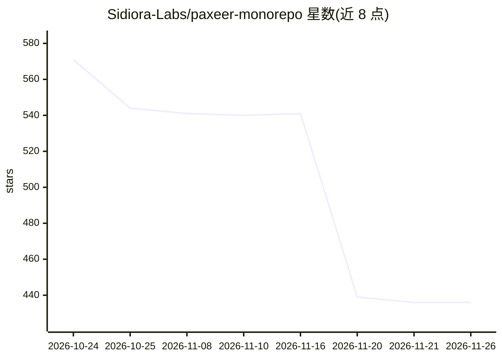

# Sidiora-Labs/paxeer-monorepo

⭐ 436 · TypeScript · NOASSERTION · 推送 2026-11-25 · [GitHub](https://github.com/Sidiora-Labs/paxeer-monorepo) · [官网](https://paxeer.network) · 组织维护

**面向机器与用户的分布式支付与意图路由区块链网络**

Sidiora Labs 开发的 Paxeer X Network，核心为运行在 paxd 节点内的 LayerX 内核：交易到达即执行、分配全局序列位置并在区块投票前返回签名执行回执；验证者只校验并重放区块，不选择或排序交易。内核上运行原生支付（托管/预算/流式）、现货与永续市场、Rust 程序、带委托权限的代理与池化推理市场、EVM 与桥。链标识 125，原生代币 PAX。仓库为包含共识、SDK、RPC、wasm 等模块的 monorepo，从源码 make 构建。

## 筛选速览

| 维度 | 判定 | 备注 |
|---|---|---|
| AI 角色 | `ai-enhanced` | 去掉 AI 部分产品仍成立 |
| 许可风险 | `none` | NOASSERTION |
| 部署形态 | `None` |  |
| 模型依赖 | — | README 未给出锁定关系 |
| 硬件要求 | — | 无带数字的原话,不猜 |
| 安装摩擦 | `low` | 无编译、无系统依赖或容器化 |
| 成熟度 | — | 结构信号不足 |

## 能力要点

- LayerX 内核执行即返回签名回执，先于区块投票
- 内核支持原生支付、现货/永续市场、Rust 程序与 EVM 预编译
- 带委托权限的 agents 与池化推理市场运行在内核上
- 提供 paxd 构建与测试的 make 入口及 Docker 目录

## 适用场景

- 搭建并运行 Paxeer X 网络节点
- 在链上进行支付、交易与意图路由
- 为链上 agents 接入池化推理市场

## 场景标签

 · 领域:区块链/分布式账本

## 证据(README 行号)

> L3: Paxeer X Network is a distributed HyperState Machine for payments, code execution and intent routing, developed by S
> L10: - Agents with delegated authority and the pooled inference market.

## 星数曲线

2026-10-24 571 → 2026-11-26 436（-135）

---
*卡片 v1 · prompt 1.4 · 生成 2026-11-25 · 置信度 mid · 依据 README sha `a0a8f313325b` · [字段定义](../../DATASET.md)*
