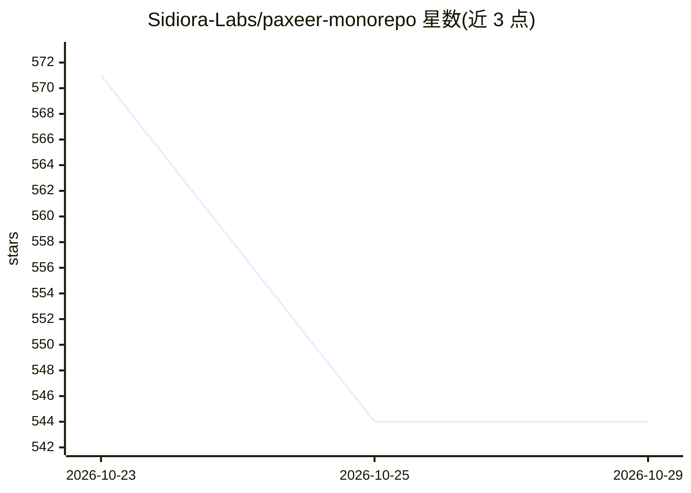

# Sidiora-Labs/paxeer-monorepo

⭐ 544 · Go · Apache-2.0 · 推送 2026-10-28 · [GitHub](https://github.com/Sidiora-Labs/paxeer-monorepo) · [官网](https://paxeer.network) · 组织维护

**面向自主 agent 的分布式执行与记账区块链网络（monorepo）**

Paxeer X Network 是一个双执行域的区块链网络 monorepo：Go 编写的 BFT+EVM 链节点 paxd（链 ID 125），以及 C17 实现的 LayerX 内核 layerxd，用于对自主 agent 的活动做确定性执行与记账并为每次活动返回签名回执。仓库还包含链上合约（Foundry）、MCP 服务器与 agent 守护进程、多语言客户端 SDK（Rust/Python/TS/Go/JVM/.NET/Swift）、托管开发者平台与钱包、永续合约前端等应用。测试网/主网 beta 尚未开放，无通用水龙头，需团队分配测试额度。从源码构建需要 Go、C17 编译器、Rust、Foundry 与 Node.js 工具链。

## 筛选速览

| 维度 | 判定 | 备注 |
|---|---|---|
| AI 角色 | `ai-ecosystem` | LLM/agent 周边工具 |
| 许可风险 | `permissive` | Apache-2.0 |
| 部署形态 | `None` |  |
| 模型依赖 | — | README 未给出锁定关系 |
| 硬件要求 | — | 无带数字的原话,不猜 |
| 安装摩擦 | `high` | 编译与系统依赖俱全 |
| 成熟度 | `idea` | |

## 能力要点

- paxd 链节点（Go，BFT 共识 + EVM 执行层，链 ID 125）
- LayerX 内核对 agent 活动做确定性执行、记账并返回签名回执，检查点经 layerxAnchor 预编译上链
- 20+ 状态预编译（staking、oracle、ibc、layerx 系列等）覆盖支付、托管、交易所、调度等
- 提供 MCP 服务器（layerx-mcp）、agent 守护进程与 7 种语言的客户端 SDK

## 适用场景

- 为自主 agent 提供确定性执行与可审计的链上记账环境
- 通过 MCP 服务器与多语言 SDK 将 agent 接入 Paxeer X 网络
- 在 EVM 链上使用支付、托管、交易与调度类预编译合约

## 场景标签

 · 领域:区块链/agent 基础设施

## 证据(README 行号)

> L5: Paxeer X Network is one network with two execution domains: the Paxeer X chain (`paxd`, Go, EVM chain ID 125) and th
> L12: - **The LayerX kernel.** LayerX is the kernel domain: the C17 daemon `layerxd` executes and accounts for agent acti
> L55: The agent daemon is `services/agent/crates/layerx-agentd` and the MCP server is `services/agent/crates/layerx-mcp`.

## 星数曲线

2026-10-23 571 → 2026-10-29 544（-27）

---
*卡片 v1 · prompt 1.4 · 生成 2026-10-28 · 置信度 mid · 依据 README sha `d20f62890bed` · [字段定义](../../DATASET.md)*
