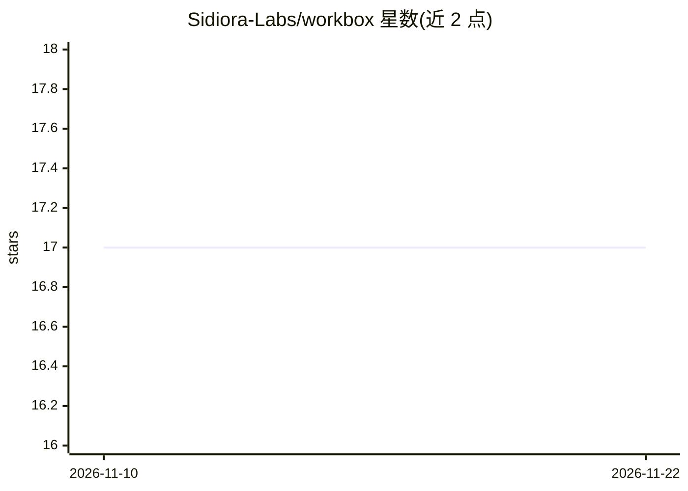

# Sidiora-Labs/workbox

⭐ 17 · JavaScript · Apache-2.0 · 推送 2026-11-18 · [GitHub](https://github.com/Sidiora-Labs/workbox) · [官网](https://workboxvm.ai) · 组织维护

**在 Linux 主机上隔离运行 AI agent 与其 shell 工具的沙箱**

面向以 shell 为主要界面的 AI agent 的沙箱系统：用 namespaces、cgroup v2 限制、削减 capability 与 seccomp 过滤隔离 Linux 进程树，每个沙箱运行在共享只读根文件系统的可写 overlay 上，内含 supervisor 与 wb 命令供 agent 自发现能力。对外提供操作 CLI、REST/WebSocket API、JavaScript SDK 与 MCP server，预装 Claude Code 与 Codex 供沙箱内调用。当前为 0.1.0-alpha.1 预发布，仅支持单台 Linux 主机加 root 守护进程，无高可用。

## 筛选速览

| 维度 | 判定 | 备注 |
|---|---|---|
| AI 角色 | `ai-ecosystem` | LLM/agent 周边工具 |
| 许可风险 | `permissive` | Apache-2.0 |
| 部署形态 | `library` | 以包/库形式分发 |
| 模型依赖 | — | README 未给出锁定关系 |
| 硬件要求 | — | 无带数字的原话,不猜 |
| 安装摩擦 | `low` | 无编译、无系统依赖或容器化 |
| 成熟度 | `idea` | |

## 能力要点

- namespaces + cgroup v2 + seccomp 的进程树沙箱（非虚拟机隔离）
- 提供 CLI、REST/WebSocket API、@workbox/sdk 与 MCP server 四类接口
- agents 根文件系统预装 Claude Code 与 Codex，支持沙箱内编码任务
- 沙箱内 wb 命令通过 --help 自发现能力，替代固定工具 schema

## 适用场景

- 把编码 agent 关进沙箱跑构建、测试与文件操作，限制其对宿主的访问
- 远程 agent 通过 URL + 作用域 API key 创建和操作沙箱，无需 SSH
- 通过 MCP server 让 Claude 类 agent 以工具方式创建/销毁/执行沙箱

## 场景标签

 · 领域:AI agent 基础设施/安全沙箱

## 证据(README 行号)

> L10: Each sandbox is a Linux process tree isolated with namespaces, cgroup v2 limits, a reduced
> L13: discover what it can do through `--help` instead of fixed tool schemas. On the host, Workbox
> L41: - MCP server (stdio, `workbox-mcp`): `sandbox_create`, `sandbox_list`, `sandbox_exec` and

## 星数曲线

2026-11-10 17 → 2026-11-22 17（+0）

---
*卡片 v1 · prompt 1.4 · 生成 2026-11-18 · 置信度 mid · 依据 README sha `b655369a61e1` · [字段定义](../../DATASET.md)*
