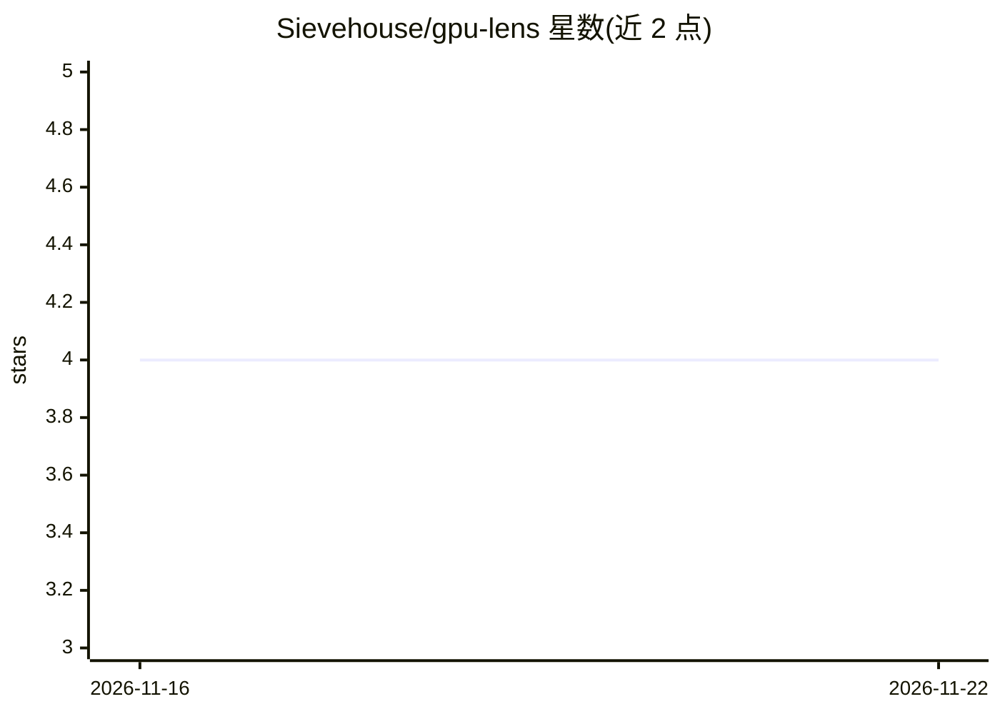

# Sievehouse/gpu-lens

⭐ 4 · Go · Apache-2.0 · 推送 2026-11-19 · [GitHub](https://github.com/Sievehouse/gpu-lens) · [官网](https://gpu-lens.onrender.com) · 组织维护

**K8s GPU 集群只读可靠性诊断控制台，输出确定性事件报告**

自托管、严格只读的 GPU 集群监控控制台：通过 nvidia-smi、DCGM Exporter、Prometheus 与 Kubernetes API（另实验性支持 amd-smi 读取 AMD GPU）采集遥测，按 6 条规则关联信号生成带支持性与矛盾性证据的确定性事件报告，并提供容量审计、告警（Slack/签名 webhook）、多集群 Fleet 视图与审计日志。明确声明不含 AI/LLM 调用，不改动集群；提供单二进制、Docker、Helm 安装及无 GPU 的模拟视图。

## 筛选速览

| 维度 | 判定 | 备注 |
|---|---|---|
| AI 角色 | `ai-ecosystem` | LLM/agent 周边工具 |
| 许可风险 | `permissive` | Apache-2.0 |
| 部署形态 | `self-host` | docker 或自建部署 |
| 模型依赖 | — | README 未给出锁定关系 |
| 硬件要求 | — | 无带数字的原话,不猜 |
| 安装摩擦 | `low` | 无编译、无系统依赖或容器化 |
| 成熟度 | — | 结构信号不足 |

## 能力要点

- 读取 DCGM/Prometheus/K8s 状态并关联生成确定性事件报告，缺失数据不会被显示为健康
- 内置 6 个无 GPU 可运行的确定性模拟场景
- Slack 与签名 JSON webhook 告警、管理员/只读双角色与审计日志
- 单二进制、Docker 镜像（amd64/arm64）或 Helm 三种部署方式

## 适用场景

- 排查 GPU 训练集群中利用率异常、XID 故障与 Pending 任务的原因
- 统一查看多集群 GPU 容量与节点健康状况
- 故障发生时通过 Slack/webhook 接收事件通知并导出证据快照
- 无 GPU 环境下通过模拟场景学习诊断规则

## 场景标签

 · 领域:基础设施/可观测性

## 证据(README 行号)

> L12: **GPU Lens** is a self-hosted, strictly **read-only** console that tells you what your GPUs are doing *right now* a
> L79: ||**GPU Lens**|**DCGM exporter + Grafana**|**NVIDIA NVSentinel**|**nvitop**|
> L123: ### E. "I run a GPU cluster (Kubernetes, DCGM, Prometheus)"

## 星数曲线

2026-11-16 4 → 2026-11-22 4（+0）

---
*卡片 v1 · prompt 1.4 · 生成 2026-11-21 · 置信度 mid · 依据 README sha `f9e69efc0039` · [字段定义](../../DATASET.md)*
