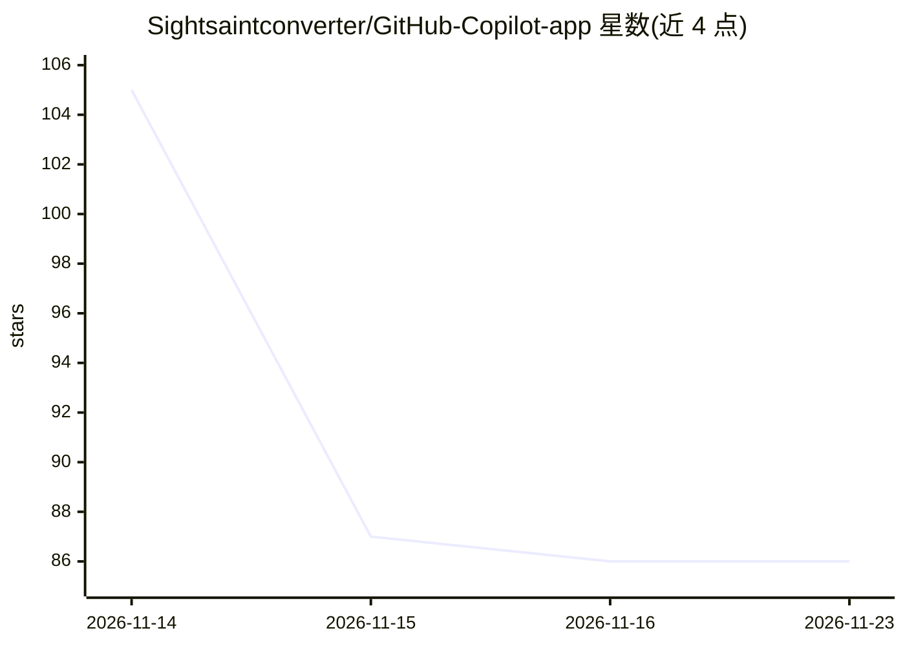

# Sightsaintconverter/GitHub-Copilot-app

⭐ 86 · Apache-2.0 · 推送 2026-11-15 · [GitHub](https://github.com/Sightsaintconverter/GitHub-Copilot-app) · 组织维护

**管理 GitHub 软件工作的 agent 桌面客户端**

面向开发者的桌面应用，作为运行与调度 GitHub Copilot agent 的统一控制中心：查找待办工作、启动并引导本地/云端 agent 会话、在 Canvas 界面查看与编辑 agent 产出、通过 My Work 汇聚会话/issue/PR 上下文，并提供 Automations 定时任务与 Agent Merge 辅助合并 PR。本地会话使用隔离的 git worktree，云端会话运行于 GitHub 托管环境。需要 Git 与任一 Copilot 订阅，或自带 API key（BYOK）；通过下载链接与 Releases 页面分发安装包。

## 筛选速览

| 维度 | 判定 | 备注 |
|---|---|---|
| AI 角色 | `ai-ecosystem` | LLM/agent 周边工具 |
| 许可风险 | `permissive` | Apache-2.0 |
| 部署形态 | `desktop` | 安装包/桌面程序 |
| 模型依赖 | — | README 未给出锁定关系 |
| 硬件要求 | — | 无带数字的原话,不猜 |
| 安装摩擦 | `low` | 无编译、无系统依赖或容器化 |
| 成熟度 | — | 结构信号不足 |

## 能力要点

- 本地会话各自运行在隔离 git worktree，云端会话运行于 GitHub 托管环境
- Canvas 界面集中展示计划、终端、diff 与工作流状态并可编辑重定向
- Automations 将可重复提示转为定时/后台任务
- 支持 BYOK 自带模型提供商，无 Copilot 订阅也可使用

## 适用场景

- 在一个桌面端并行管理多个 agent 开发会话
- 把计划、diff、预览集中到可检视的画布中审阅 agent 工作
- 用定时自动化任务处理重复性提示与流程

## 场景标签

`编码 Agent` · 领域:编码与开发

## 证据(README 行号)

> L13: The GitHub Copilot app is an agent-native desktop experience for managing software work from idea to pull request. 
> L15: The app is built for parallel agent-driven development. Each local session runs in its own isolated git worktree, a

## 星数曲线

2026-11-14 105 → 2026-11-23 86（-19）

---
*卡片 v1 · prompt 1.4 · 生成 2026-11-17 · 置信度 high · 依据 README sha `3b7a076fe5ce` · [字段定义](../../DATASET.md)*
