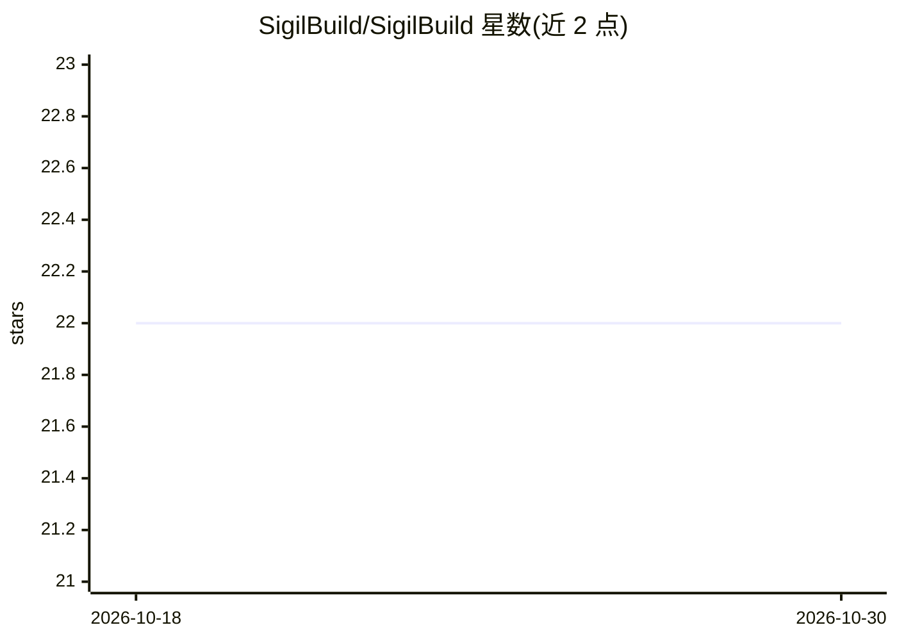

# SigilBuild/SigilBuild

⭐ 22 · TypeScript · MIT · 推送 2026-07-13 · [GitHub](https://github.com/SigilBuild/SigilBuild) · 组织维护

**用自然语言生成 Solana Anchor 程序的 AI 代码生成工具**

面向 Solana 开发者的 AI agent 工具：输入英文描述，经 Claude 驱动的 4 步设计循环（选模板、设计账户、设计指令、生成程序）输出完整可编译的 Anchor 项目，含 Rust 源码、IDL、Cargo.toml、Anchor.toml、测试与文档。内置 6 类模板（staking/vault/token/nft/governance/custom），在生成时计算精确账户 space、存储 canonical bump、检查指令重名与未签名状态变更。需配置 ANTHROPIC_API_KEY，通过 git clone 源码加 bun 安装运行。

## 筛选速览

| 维度 | 判定 | 备注 |
|---|---|---|
| AI 角色 | `ai-native` | 本体是模型或模型工具 |
| 许可风险 | `permissive` | MIT |
| 部署形态 | `None` |  |
| 模型依赖 | locked-api |  |
| 硬件要求 | — | 无带数字的原话,不猜 |
| 安装摩擦 | `low` | 无编译、无系统依赖或容器化 |
| 成熟度 | — | 结构信号不足 |

## 能力要点

- 4 步 agent 循环：选模板→设计账户→设计指令→生成程序
- 生成含 Rust 源码、IDL、配置文件、测试与文档的完整 Anchor 项目
- 设计期检查：精确 space 计算、指令重名检测、未签名状态变更告警
- 生成的 u64 运算默认使用 checked_add/checked_sub

## 适用场景

- 用一句描述快速产出可编译的 Anchor 合约骨架
- 基于 staking/vault/token 等模板定制 Solana 程序
- 在开发早期规避 String 平铺 64、重名指令等常见 Anchor 坑

## 场景标签

`代码生成` · 领域:编码与开发

## 证据(README 行号)

> L10: Sigil is an AI agent that turns plain-English descriptions into complete, production-ready Solana Anchor programs —
> L29: Description → Claude agent loop → program design → code emitter → Anchor project
> L83: |`ANTHROPIC_API_KEY`|—|Required|

## 星数曲线

2026-10-18 22 → 2026-10-30 22（+0）

---
*卡片 v1 · prompt 1.4 · 生成 2026-10-27 · 置信度 high · 依据 README sha `68a76fee9e59` · [字段定义](../../DATASET.md)*
