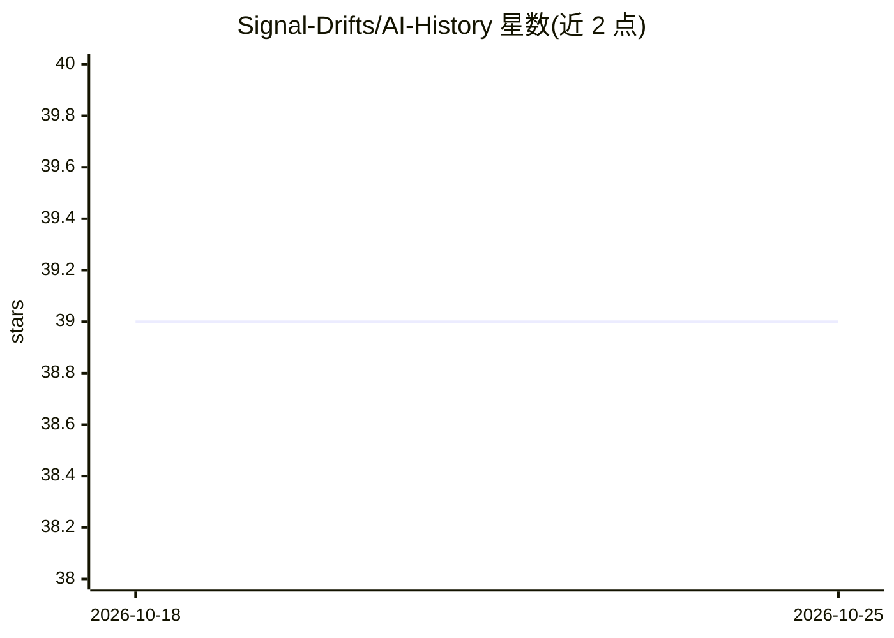

# Signal-Drifts/AI-History

⭐ 39 · 推送 2026-05-08 · [GitHub](https://github.com/Signal-Drifts/AI-History) · 个人维护

**按时间顺序逐篇讲述 90 年 AI 史的 66 章科普读物仓库**

以叙事方式系统梳理 1936 年图灵到 2025 年 Blackwell 的 AI 发展史，共 66 章、分 8 个时代（符号主义、AI 寒冬、统计时代、深度学习、生成时代等）。每章围绕一篇里程碑论文或事件，配自绘示意图，用通俗语言讲其内容、作者与影响，单章阅读约 10-15 分钟，全程约 12-15 小时；章末附下一篇链接可顺序阅读。面向从零基础读者到资深研究者的所有人群，无需数学或术语门槛，MIT 许可，接受 issue 与 PR 修订。

## 筛选速览

| 维度 | 判定 | 备注 |
|---|---|---|
| AI 角色 | `ai-knowledge` | 知识聚合/清单类 |
| 许可风险 | `none` | — |
| 部署形态 | `None` |  |
| 模型依赖 | — | README 未给出锁定关系 |
| 硬件要求 | — | 无带数字的原话,不猜 |
| 安装摩擦 | `medium` | 含编译或系统依赖之一 |
| 成熟度 | — | 结构信号不足 |

## 能力要点

- 66 章覆盖 1936-2025 年、8 个时代的 AI 史
- 每章围绕一篇里程碑论文/事件，配定制图示与通俗叙述
- 章末链接串联，支持顺序通读
- MIT 许可，开放 issue/PR 修订

## 适用场景

- 作为系统了解 AI 发展脉络的入门读物
- 科研者或工程师回顾领域关键节点与思想传承
- 课堂教学或自学的 AI 历史阅读材料

## 场景标签

`教程课程` · 领域:学习与行业

## 证据(README 行号)

> L31: |Era|Years|Chapters|Theme|
> L46: Each chapter is a short, plain-language summary of a landmark paper, theory, or moment that shaped the field — what

## 星数曲线

2026-10-18 39 → 2026-10-25 39（+0）

---
*卡片 v1 · prompt 1.4 · 生成 2026-10-25 · 置信度 high · 依据 README sha `789460759bd3` · [字段定义](../../DATASET.md)*
