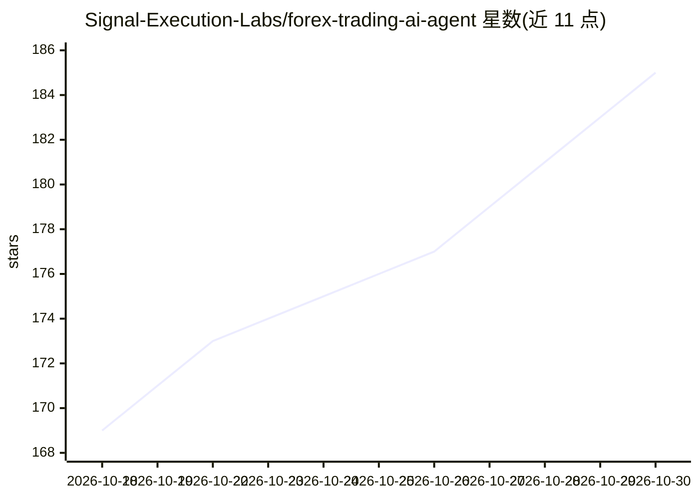

# Signal-Execution-Labs/forex-trading-ai-agent

⭐ — · [GitHub]() · 组织维护

**个人 AI 交易代理：自动交易加密/外汇/股票**

K.I.T. 是一个基于 Node.js/TypeScript 的量化交易平台，以 CLI 与 Dashboard 形式提供：连接交易所后可由 AI 代理按自然语言指令自主交易，也可作为开发者框架用 SDK 构建自有机器人。内置 66 个技能（ML 价格预测 LSTM/XGBoost、情绪分析、网格/DCA、套利、社交跟单、Pine Script 生成等），支持手动/半自动/全自动三种模式，附带每日最大亏损 5%、最大回撤 15% 等风控默认值与一键平仓。通过 npm 安装，需连接交易所或使用 demo 模式。

## 筛选速览

| 维度 | 判定 | 备注 |
|---|---|---|
| AI 角色 | `ai-enhanced` | 去掉 AI 部分产品仍成立 |
| 许可风险 | `permissive` | — |
| 部署形态 | `library` | 以包/库形式分发 |
| 模型依赖 | — | README 未给出锁定关系 |
| 硬件要求 | — | 无带数字的原话,不猜 |
| 安装摩擦 | `low` | 无编译、无系统依赖或容器化 |
| 成熟度 | — | 结构信号不足 |

## 能力要点

- 66 个内置交易技能（AI 预测、套利、网格、跟单、税务等）
- 自然语言指令控制（如 'Buy BTC when RSI below 30'）
- 自然语言转 TradingView Pine Script v5 代码生成
- 三档自动化模式与内置风控限额、Kill Switch

## 适用场景

- 挂一个 24 小时自动交易的 AI 代理替我盯盘下单
- 从 Telegram 频道自动复制并解析交易信号
- 用 SDK 自己写网格、DCA 或套利机器人
- 用回测和模拟盘先验证策略再实盘

## 场景标签

`金融量化` · 领域:学习与行业

## 证据(README 行号)

> L16: K.I.T. is your **personal AI trading agent** - like having a professional trader working for you 24/7. Just tell it
> L67: ### 2️⃣ As a Framework for Developers
> L215: |`ai-predictor`|ML price predictions (LSTM, XGBoost)|

## 星数曲线

2026-10-18 169 → 2026-10-30 185（+16）

---
*卡片 v1 · prompt 1.4 · 生成 2026-10-22 · 置信度 mid · 依据 README sha `9bfe96e498c3` · [字段定义](../../DATASET.md)*
