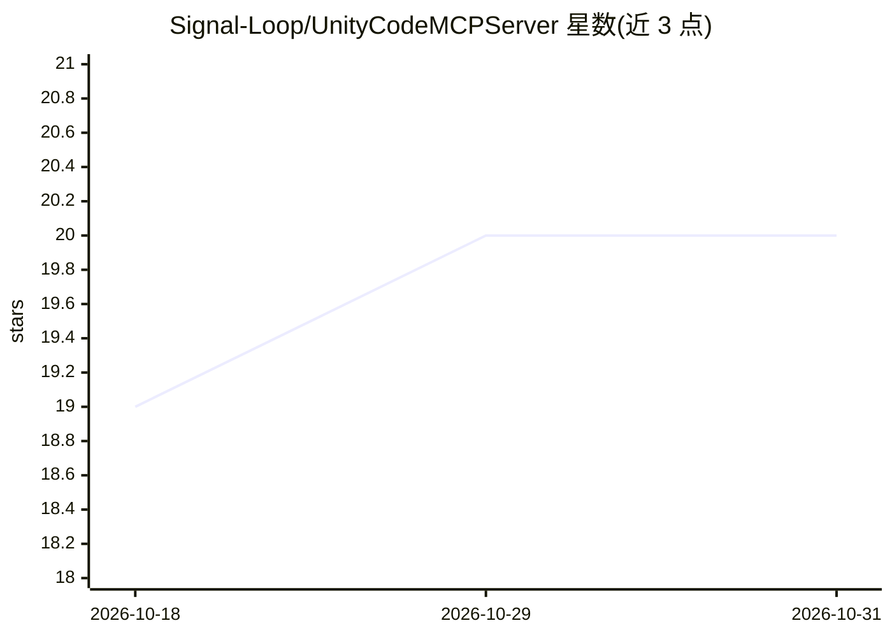

# Signal-Loop/UnityCodeMCPServer

⭐ 20 · C# · MIT · 推送 2026-08-31 · [GitHub](https://github.com/Signal-Loop/UnityCodeMCPServer) · 组织维护

**让 AI Agent 通过 MCP 直接操作 Unity Editor 的服务器**

运行在 Unity Editor 内部的 MCP 服务器包，通过文件中转的 STDIO 桥与外部 MCP 客户端（LLM agent）通信。提供 8 个工具：在 Editor 上下文执行 LLM 生成的 C# 脚本（可访问 UnityEngine/UnityEditor API 与反射）、读取控制台日志、运行 Edit/Play Mode 测试、进入/退出 Play Mode、模拟 Input System 输入、截图与读取运行时状态。内置两个 agent 技能文档，支持实现 ITool 等接口扩展工具。需 Unity 2022.3 LTS 及以上与 uv。

## 筛选速览

| 维度 | 判定 | 备注 |
|---|---|---|
| AI 角色 | `ai-ecosystem` | LLM/agent 周边工具 |
| 许可风险 | `permissive` | MIT |
| 部署形态 | `None` |  |
| 模型依赖 | — | README 未给出锁定关系 |
| 硬件要求 | — | 无带数字的原话,不猜 |
| 安装摩擦 | `low` | 无编译、无系统依赖或容器化 |
| 成熟度 | — | 结构信号不足 |

## 能力要点

- 在 Unity Editor 上下文执行 LLM 生成的 C# 脚本，自动捕获日志、错误与返回值
- 进入 Play Mode、模拟 Input System 输入、截图、读控制台日志的闭环游戏自动化工具
- 附带 2 个 agent 技能文档（脚本执行管线、闭环游戏测试），安装包时自动部署
- 实现 ITool/IPrompt/IResource 接口即可自动注册扩展工具

## 适用场景

- 让 AI agent 检查并修改 Unity 场景、预制体与资产
- agent 在 Play Mode 中模拟输入、闭环测试并验证游戏行为
- 自动运行 Unity 测试并根据控制台输出调试

## 场景标签

`编码 Agent` `GUI 自动化` · 领域:效率与自动化

## 证据(README 行号)

> L61: *Architecture diagram: The Unity Code MCP Server package runs inside the Unity Editor and communicates with an exte
> L67:     A["MCP Client AI Agent"] -->|STDIO| B["STDIO Bridge Python script"]

## 星数曲线

2026-10-18 19 → 2026-10-31 20（+1）

---
*卡片 v1 · prompt 1.4 · 生成 2026-10-28 · 置信度 high · 依据 README sha `6f9899e040e1` · [字段定义](../../DATASET.md)*
