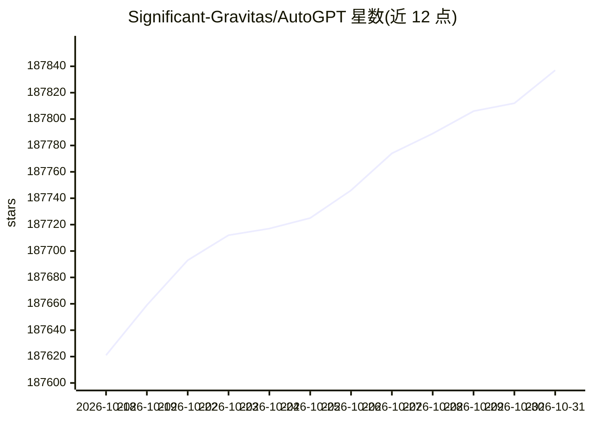

# Significant-Gravitas/AutoGPT

⭐ 187,837 · Python · NOASSERTION · 推送 2026-10-30 · [GitHub](https://github.com/Significant-Gravitas/AutoGPT) · [官网](https://agpt.co) · 组织维护

**面向用户与开发者的 AI agent 构建与运行平台**

AutoGPT 提供构建、部署和运行 AI agent 的开源平台，支持用自然语言描述任务（AutoPilot）或在可视化画布（Build）中逐步编排工作流，agent 可按需、按计划或由触发器运行。平台包含 Agents 仪表盘与 Marketplace 社区 agent 市场，连接 45+ 平台与数百个 AI 模型。提供托管 Platform（付费、含模型访问）与自托管（免费、需自备 Docker 基础设施与模型 API key）两条路径；原独立版 AutoGPT Classic 保留于 classic/ 目录，采用 MIT 许可证。

## 筛选速览

| 维度 | 判定 | 备注 |
|---|---|---|
| AI 角色 | `ai-native` | 本体是模型或模型工具 |
| 许可风险 | `none` | NOASSERTION |
| 部署形态 | `None` |  |
| 模型依赖 | — | README 未给出锁定关系 |
| 硬件要求 | — | 无带数字的原话,不猜 |
| 安装摩擦 | `low` | 无编译、无系统依赖或容器化 |
| 成熟度 | — | 结构信号不足 |

## 动量与使用信号

- 维护:`active` — 距上次 push 0.7 天,年发版 48,425 位贡献者
- 涨星:近 1 天 **+16**(自 20261016 起算)

## 能力要点

- AutoPilot 对话转 agent 与可视化 Build 画布两种构建方式
- 45+ 平台集成（Gmail、GitHub、Slack、Notion 等）
- 托管 Platform 与自托管双路径，同一代码仓库
- AutoGPT Classic 以 MIT 许可证保留在 classic/ 目录

## 适用场景

- 用自然语言把日常流程变成定时或触发式运行的 agent
- 自托管平台并接入自己的模型 API key 构建自动化工作流
- 从 Marketplace 选取现成社区 agent 定制使用
- 用 Classic 版本构建或基准测试独立 agent

## 场景标签

`Agent 框架` `工作流自动化` · 领域:Agent 开发

## 证据(README 行号)

> L31: AutoGPT lets you build, deploy, and run AI agents that carry out complete workflows. Describe an outcome in plain E
> L84: ### Self-host AutoGPT
> L155: Looking for the original standalone AutoGPT agent? It remains available in `classic/` under the MIT License.

## 星数曲线

2026-10-18 187,621 → 2026-10-31 187,837（+216）

---
*卡片 v1 · prompt 1.4 · 生成 2026-10-18 · 置信度 high · 依据 README sha `d9b3cba04445` · [字段定义](../../DATASET.md)*
