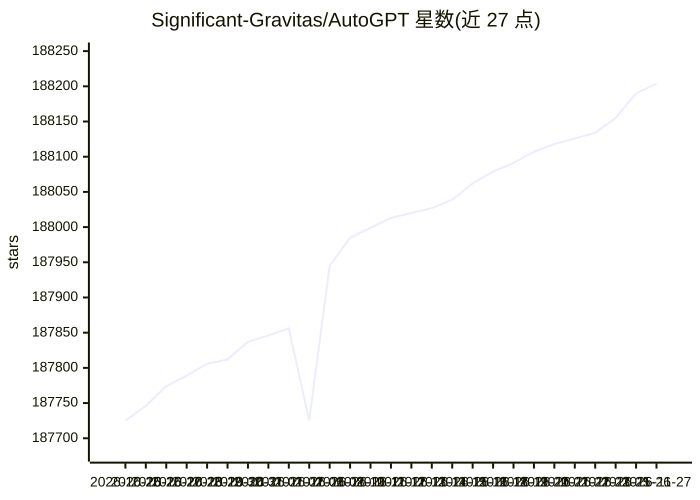

# Significant-Gravitas/AutoGPT

⭐ 188,204 · Python · NOASSERTION · 推送 2026-11-26 · [GitHub](https://github.com/Significant-Gravitas/AutoGPT) · [官网](https://agpt.co) · 组织维护

**给企业和个人的一组可指挥的 AI 专家团队平台**

AutoGPT 提供多个角色化的 AI 专家（Otto 协调、Maria 内容、Max 销售、Frankie 助理），用户用自然语言布置任务，由协调者分派给专家并汇总结果。专家可自定义指令、上下文、技能与连接的应用；支持例程化重复任务、支出控制与账户授权。提供托管平台（付费试用）与自托管两条路径，自托管支持单容器 Docker 镜像、安装器以及 Docker Compose/源码方式；附可视化工作流构建器、市场与 API/MCP server。原独立版以 AutoGPT Classic 形式另行提供。

## 筛选速览

| 维度 | 判定 | 备注 |
|---|---|---|
| AI 角色 | `ai-native` | 本体是模型或模型工具 |
| 许可风险 | `none` | NOASSERTION |
| 部署形态 | `self-host` | docker 或自建部署 |
| 模型依赖 | — | README 未给出锁定关系 |
| 硬件要求 | — | 无带数字的原话,不猜 |
| 安装摩擦 | `low` | 无编译、无系统依赖或容器化 |
| 成熟度 | — | 结构信号不足 |

## 动量与使用信号

- 维护:`active` — 距上次 push 0.7 天,年发版 48,425 位贡献者
- 涨星:近 1 天 **+16**(自 20261016 起算)

## 能力要点

- 多专家协作：Otto 协调多角色专家完成任务
- 可视化工作流构建器与工作流市场
- 支持托管平台与 Docker 自托管部署
- 提供 API 和 MCP server 以代码或 AI 编码 agent 驱动工作流

## 适用场景

- 把内容创作、销售研究、日常行政任务交给多个 AI 专家分工完成
- 将重复性工作固化为可复用的例程或工作流
- 在自有基础设施上部署并掌控数据与模型凭证

## 场景标签

`工作流自动化` `多智能体` · 领域:Agent 开发

## 证据(README 行号)

> L5:  AutoGPT — Your team of AI Experts
> L68: Use the hosted Platform to get your team running without managing the infrastructure or supplying model API keys.
> L118: Experts can use skills and workflows to do their jobs. The visual builder lets you define repeatable steps, connec

## 星数曲线

2026-10-25 187,725 → 2026-11-27 188,204（+479）

---
*卡片 v1 · prompt 1.4 · 生成 2026-11-22 · 置信度 high · 依据 README sha `a61709f5ba48` · [字段定义](../../DATASET.md)*
