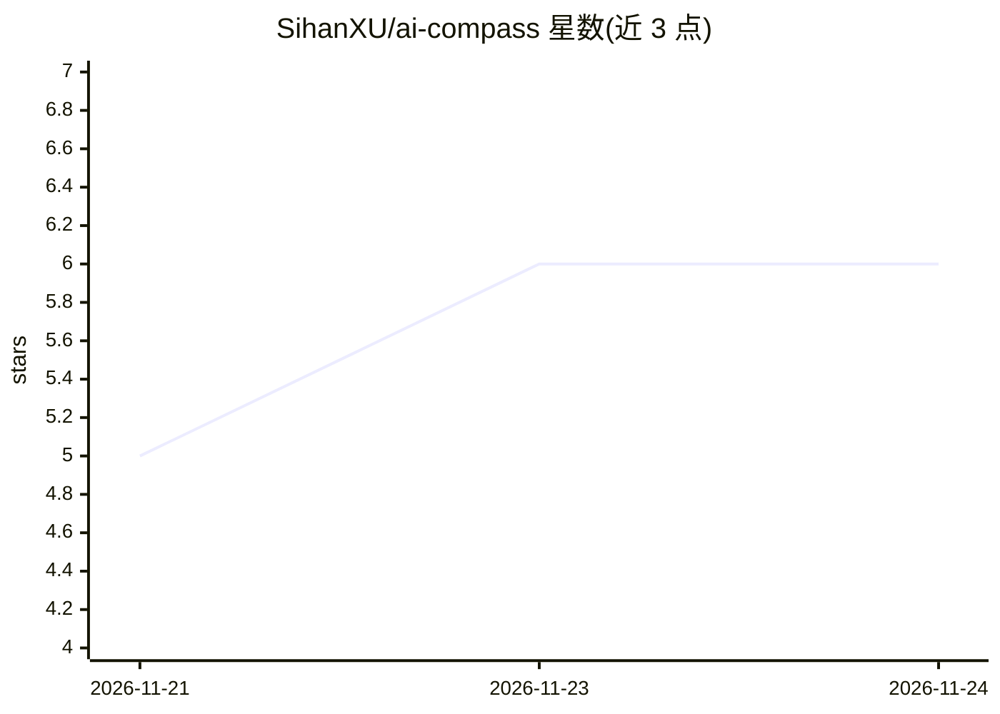

# SihanXU/ai-compass

⭐ 6 · Astro · NOASSERTION · 推送 2026-11-21 · [GitHub](https://github.com/SihanXU/ai-compass) · [官网](https://sihanxu.me/ai-compass/) · 个人维护 · 中文 README

**AI 研究立场的政治罗盘：图谱、测试与百科**

以 Astro 构建的静态站点，为 AI 研究方向绘制'政治立场图谱'：在 13×12 网格上放置 165 种研究立场/主义，提供 10 题快速版、50 题完整版与 120 题+自适应追问的专业版三套测试，结果以链接与图片分享；每种立场配有中英文 wiki 词条（主张、论据、批评、代表作品与关系）。数据以 YAML/Markdown 组织，含校准脚本与 PR 校验脚本，代码 MIT、内容 CC BY-SA 4.0 双重许可。

## 筛选速览

| 维度 | 判定 | 备注 |
|---|---|---|
| AI 角色 | `ai-knowledge` | 知识聚合/清单类 |
| 许可风险 | `none` | NOASSERTION |
| 部署形态 | `library` | 以包/库形式分发 |
| 模型依赖 | — | README 未给出锁定关系 |
| 硬件要求 | — | 无带数字的原话,不猜 |
| 安装摩擦 | `low` | 无编译、无系统依赖或容器化 |
| 成熟度 | — | 结构信号不足 |

## 能力要点

- 165 种研究立场分布在 13×12 图谱上
- 三套测试：10 题快速版、50 题五轴完整版、120 题含自适应追问与一致性分数的专业版
- 每种立场的中英文 wiki 词条
- 数据文件以 YAML/Markdown 组织并附校验与校准脚本

## 适用场景

- 测一测自己的 AI 研究立场落在图谱哪个位置
- 查询某种 AI 研究范式的中英文词条与代表作品
- 以 PR 贡献新立场或修订测试题目

## 场景标签

 · 领域:AI 研究/知识聚合

## 证据(README 行号)

> L7: - **Chart** — 165 ideologies on a 13 × 12 grid with a ring of extreme titles, shaded by paradigm, like the big ideol
> L9: - **Wiki** — an entry for every ideology in English and Chinese: beliefs, arguments, critiques, representative works
> L11: 给 AI 研究做一张政治图谱：图谱、三套测试（简单版、完整版、专业版）、每个主义的中英文百科词条。

## 星数曲线

2026-11-21 5 → 2026-11-24 6（+1）

---
*卡片 v1 · prompt 1.4 · 生成 2026-11-21 · 置信度 high · 依据 README sha `594d0ecf465e` · [字段定义](../../DATASET.md)*
