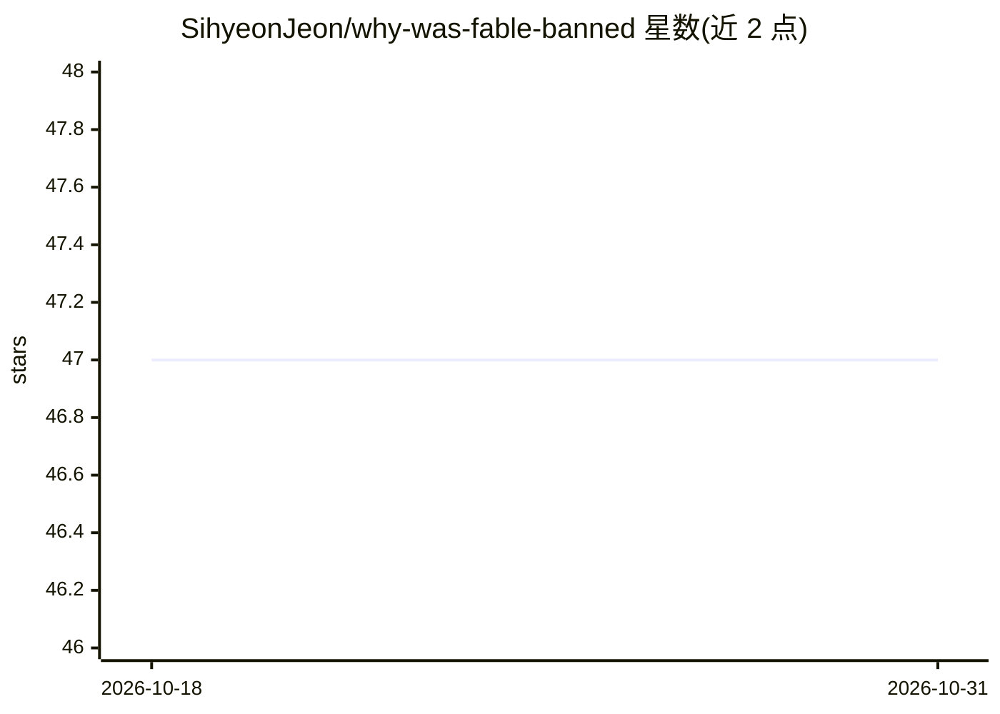

# SihyeonJeon/why-was-fable-banned

⭐ 47 · Python · MIT · 推送 2026-06-30 · [GitHub](https://github.com/SihyeonJeon/why-was-fable-banned) · 个人维护 · 中文 README

**约束 AI 编程代理的规范前置门禁钩子：规范不过则禁止编辑**

面向 Claude Code 与 Codex 的编辑门禁工具：通过 PreToolUse 钩子（exit 2）拦截代理的每次代码编辑，直到代理写出 .wfb/spec.json（含目标复述、非目标、≥2 个被否决的备选方案、风险、可运行验收命令等）并通过确定性校验；'完成'需验收命令输出实时证据（fail-closed），禁止路径强制执行，高风险任务自动升级到更重门禁。Codex 变更仅在一次性 worktree 中落地。仅依赖 python3 标准库，git clone 后运行 install.sh 安装，支持机器级/项目级安装与会话内三级开关。README 自述基准提升幅度小且在噪声内，价值在于流程强制与可审计决策记录。

## 筛选速览

| 维度 | 判定 | 备注 |
|---|---|---|
| AI 角色 | `ai-ecosystem` | LLM/agent 周边工具 |
| 许可风险 | `permissive` | MIT |
| 部署形态 | `None` |  |
| 模型依赖 | — | README 未给出锁定关系 |
| 硬件要求 | — | 无带数字的原话,不猜 |
| 安装摩擦 | `low` | 无编译、无系统依赖或容器化 |
| 成熟度 | — | 结构信号不足 |

## 能力要点

- PreToolUse 钩子拦截编辑，spec 通过前 exit 2 阻断
- 验收命令须输出实时证据，fail-closed 禁止无证据的'完成'
- 高风险任务（auth/迁移）自动升级到 HEAVY 门禁，错别字走 LIGHT
- Codex 变更仅经一次性 worktree 落地，只应用通过门禁的 diff

## 适用场景

- 让 Claude Code/Codex 在写代码前必须先产出并通过结构化规范
- 强制 AI 代理的每次变更附带可复跑的验收证据与决策记录
- 防止 AI 代理触碰禁止路径或提交未验证的变更

## 场景标签

 · 领域:AI 编程工具/代理护栏

## 证据(README 行号)

> L5: > Gate for AI coding agents: blocks edits until a spec passes.
> L76: - **Block**: a `PreToolUse` hook intercepts every edit and exits 2 until the spec passes
> L142: **What is why-was-fable-banned (WFB)?** A spec-first, evidence-gated edit boundary for

## 星数曲线

2026-10-18 47 → 2026-10-31 47（+0）

---
*卡片 v1 · prompt 1.4 · 生成 2026-10-25 · 置信度 high · 依据 README sha `a04812d305fb` · [字段定义](../../DATASET.md)*
