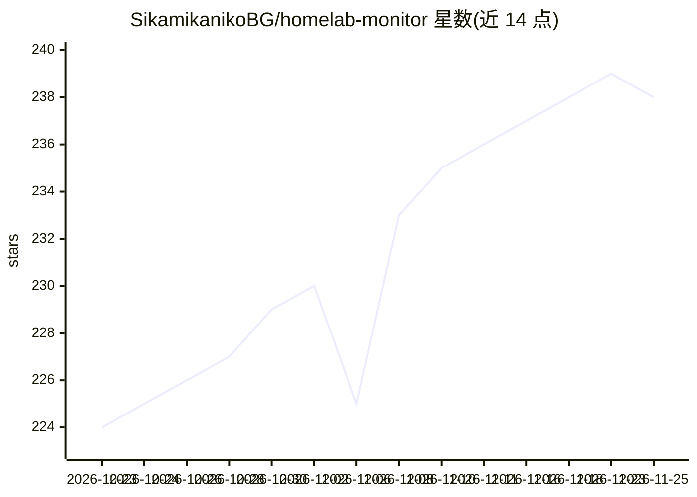

# SikamikanikoBG/homelab-monitor

⭐ 238 · Python · MIT · 推送 2026-11-23 · [GitHub](https://github.com/SikamikanikoBG/homelab-monitor) · [官网](https://sikamikanikobg.github.io/homelab-monitor/) · 个人维护

**自托管 homelab 监控面板，内置可问答的 AI agent 与 MCP 服务**

单容器自托管的 homelab 监控面板：经 SSH 汇聚多台主机的 GPU、容器、systemd、磁盘、能耗与成本数据，提供 Overview/GPU/Costs 等标签页与 Discord/ntfy/Telegram 告警。内置 AI agent 复用 MCP 工具读取面板数据回答提问，操作须按每台机器的策略审批后执行；另提供只读 MCP server 供外部 agent 接入。AI 功能默认关闭，需在 Overview 中启用。

## 筛选速览

| 维度 | 判定 | 备注 |
|---|---|---|
| AI 角色 | `ai-enhanced` | 去掉 AI 部分产品仍成立 |
| 许可风险 | `permissive` | MIT |
| 部署形态 | `self-host` | docker 或自建部署 |
| 模型依赖 | local-ok | 支持本地模型 |
| 硬件要求 | `cpu-ok` | |
| 安装摩擦 | `low` | 无编译、无系统依赖或容器化 |
| 成熟度 | — | 结构信号不足 |

## 能力要点

- 内置 AI agent，以文本和表格回答关于实验室的问题，操作需审批
- 提供只读 MCP server，供 AI agents 探索面板数据
- GPU 监控支持 NVIDIA 降频原因解码与 AMD/Intel 显卡（无需 ROCm）
- 按进程/容器/模型计量能耗成本，支持日夜电价

## 适用场景

- 一页查看所有主机与 GPU 的状态、占用与故障
- 用自然语言询问实验室状况并审批维护操作
- 按机器和进程核算电费成本
- 设置定时巡检例程（磁盘、GPU 健康、容器健康）

## 场景标签

 · 领域:运维/基础设施监控

## 证据(README 行号)

> L12: **Ask your homelab.** One self-hosted page for every box and GPU you run — and an AI agent that reads all of it, an
> L36: **It answers from what the dashboard actually measures.** Ask from the **Ask your lab** card on the Overview, the f
> L43: **Your models, your rules.** It finds the model servers already on your network — Ollama, vLLM, llama.cpp, LM Studi

## 星数曲线

2026-10-23 224 → 2026-11-25 238（+14）

---
*卡片 v1 · prompt 1.4 · 生成 2026-11-25 · 置信度 mid · 依据 README sha `21ccbe530ae0` · [字段定义](../../DATASET.md)*
