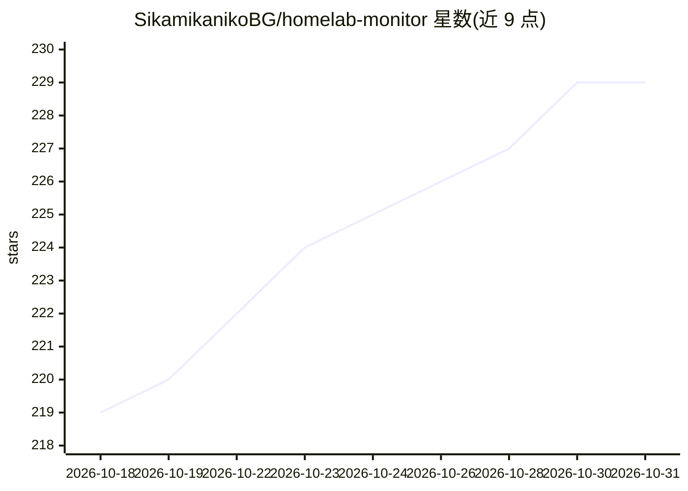

# SikamikanikoBG/homelab-monitor

⭐ 229 · Python · MIT · 推送 2026-10-30 · [GitHub](https://github.com/SikamikanikoBG/homelab-monitor) · [官网](https://sikamikanikobg.github.io/homelab-monitor/) · 个人维护

**自托管家庭实验室监控面板：GPU/容器/成本/AI 模型一页掌握**

单容器部署的自托管监控面板，通过 SSH 采集多台 Linux/Windows 主机的 GPU（NVIDIA via nvidia-smi、AMD via amdgpu）、Docker 容器、systemd、磁盘与能耗成本数据，存入 SQLite。面向运行本地 AI 的家庭实验室用户：可识别 30+ 模型服务器（Ollama、vLLM、llama.cpp 等）、对本地 ollama 模型做上下文基准测试（tokens/sec、VRAM 拟合），并内置只读 MCP 服务器（19 个工具）供 AI agent 查询。无代理、无云依赖。

## 筛选速览

| 维度 | 判定 | 备注 |
|---|---|---|
| AI 角色 | `ai-ecosystem` | LLM/agent 周边工具 |
| 许可风险 | `permissive` | MIT |
| 部署形态 | `self-host` | docker 或自建部署 |
| 模型依赖 | local-ok | 支持本地模型 |
| 硬件要求 | `cpu-ok` | |
| 安装摩擦 | `low` | 无编译、无系统依赖或容器化 |
| 成熟度 | — | 结构信号不足 |

## 能力要点

- 多机 SSH 采集，远端无需安装任何东西
- 内置只读 MCP 服务器（19 个工具），Claude 等 MCP 客户端一行接入
- Benchmark Lab 对本地 ollama 模型扫描上下文阶梯，记录 tokens/sec 与 VRAM 拟合
- 能耗按机器/组件/进程/容器/模型折算为电费，支持峰谷电价

## 适用场景

- 监控多台主机的 GPU 占用、温度与哪个模型占着显存
- 查看每个容器/模型/训练任务花了多少电费
- 测试本地模型在自家显卡上能跑多大上下文
- 让 AI agent 通过 MCP 查询整个实验室状态

## 场景标签

`LLM 可观测性` · 领域:评测与运维

## 证据(README 行号)

> L99: The hub stitches `nvidia-smi` (plus AMD GPUs via the in-kernel `amdgpu` sysfs interface, and AMD/Intel on Windows h
> L109: HomeLab Monitor isn't just a dashboard for *you* anymore; it's context for your AI agent too. A **read-only MCP se

## 星数曲线

2026-10-18 219 → 2026-10-31 229（+10）

---
*卡片 v1 · prompt 1.4 · 生成 2026-10-22 · 置信度 high · 依据 README sha `4efaf9e5cd03` · [字段定义](../../DATASET.md)*
