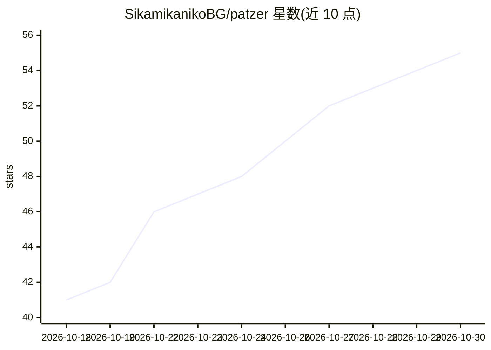

# SikamikanikoBG/patzer

⭐ 55 · TypeScript · MIT · 推送 2026-10-29 · [GitHub](https://github.com/SikamikanikoBG/patzer) · [官网](https://sikamikanikobg.github.io/patzer/) · 个人维护

**自托管的私有国际象棋平台：复盘、对弈与本地 LLM 教练**

单容器自托管国际象棋应用：从 Chess.com/Lichess 导入公开对局或粘贴 PGN，用内置 Stockfish 做 Game Review（走法分级、准确率、eval 曲线、'What's the threat?'）；支持七档 Stockfish 人机对弈、同服 WebSocket 好友对战、69 课互动教程、开局训练器与多用户家庭管理。AI Coach 需接入用户自有的 Ollama 或 vLLM 主机（或 DeepSeek API），LLM 只解释服务端由 Stockfish 与 chess.js 计算的事实，回答经引擎校验后才展示。Docker 部署，也提供源码开发与远程部署脚本。

## 筛选速览

| 维度 | 判定 | 备注 |
|---|---|---|
| AI 角色 | `ai-enhanced` | 去掉 AI 部分产品仍成立 |
| 许可风险 | `permissive` | MIT |
| 部署形态 | `self-host` | docker 或自建部署 |
| 模型依赖 | local-ok | 支持本地模型 |
| 硬件要求 | — | 无带数字的原话,不猜 |
| 安装摩擦 | `low` | 无编译、无系统依赖或容器化 |
| 成熟度 | `idea` | |

## 能力要点

- Chess.com/Lichess 对局导入与 chess.com 式走法分级复盘（内置 Stockfish）
- AI Coach 接入自有 Ollama/vLLM，事实由服务端计算、回答经引擎校验防幻觉
- 多用户家庭场景：admin 控制台、儿童模式走法警告、五语界面
- 单 Docker 容器，可运行于树莓派/NAS/旧笔记本

## 适用场景

- 在家庭服务器上私有化复盘我的 Chess.com 和 Lichess 对局
- 和家人在同一服务器上对弈并用本地 LLM 教练学棋
- 不把棋局数据上传云端，用本地模型跑 AI 教练

## 场景标签

 · 领域:游戏/自托管应用

## 证据(README 行号)

> L96: > **What works without any extras:** play vs Stockfish, play vs friend on the same server,
> L100: > **What needs an LLM:** the AI Coach commentary voice. Until you point Patzer at an Ollama or
> L101: > vLLM host, the *Coach* panel just shows the engine facts in plain text.

## 星数曲线

2026-10-18 41 → 2026-10-30 55（+14）

---
*卡片 v1 · prompt 1.4 · 生成 2026-10-25 · 置信度 high · 依据 README sha `1afbdc4ba63e` · [字段定义](../../DATASET.md)*
