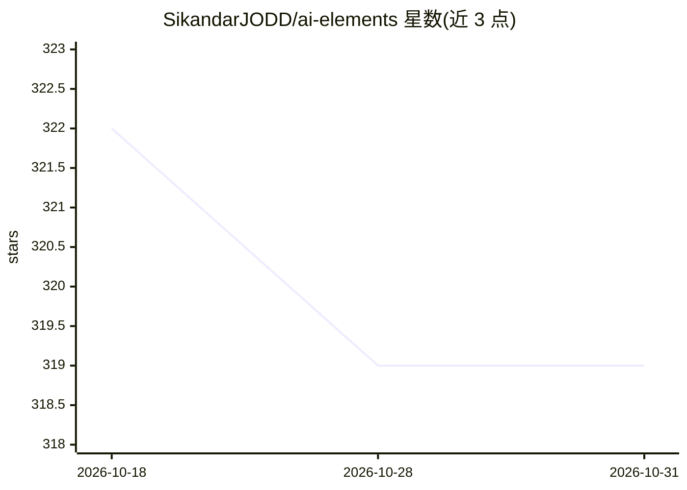

# SikandarJODD/ai-elements

⭐ 319 · Svelte · MIT · 推送 2026-10-15 · [GitHub](https://github.com/SikandarJODD/ai-elements) · [官网](https://svelte-ai-elements.vercel.app) · 个人维护

**给 Svelte 开发者的 AI 聊天/流式 UI 组件库（Vercel AI Elements 移植）**

基于 shadcn-svelte 的组件库，将 Vercel AI Elements 非官方移植到 Svelte。提供聊天消息、提示输入、流式 markdown 渲染、推理视图等组件与工具，供开发者构建 AI 应用界面。通过 shadcn-svelte CLI 从注册表按需添加组件安装；markdown 流式渲染使用 streamdown-svelte。附两个子库：全功能组件集与轻量 Prompt Kit。MIT 许可。

## 筛选速览

| 维度 | 判定 | 备注 |
|---|---|---|
| AI 角色 | `ai-ecosystem` | LLM/agent 周边工具 |
| 许可风险 | `permissive` | MIT |
| 部署形态 | `None` |  |
| 模型依赖 | — | README 未给出锁定关系 |
| 硬件要求 | — | 无带数字的原话,不猜 |
| 安装摩擦 | `low` | 无编译、无系统依赖或容器化 |
| 成熟度 | — | 结构信号不足 |

## 能力要点

- 聊天/流式响应/推理视图/工具调用类 UI 组件
- 通过 shadcn-svelte CLI 注册表按需安装组件
- 含 Svelte Prompt Kit 轻量提示工程组件集

## 适用场景

- 用 Svelte 快速搭建 AI 聊天应用界面
- 渲染流式 markdown 回复与推理过程视图
- 复用提示输入与对话结构组件

## 场景标签

 · 领域:AI 前端 UI 组件

## 证据(README 行号)

> L9: **Svelte AI Elements** is a unofficial port of Vercel AI Elements for Svelte. It provides a set of components and ut
> L47: Full-featured components for chat apps, streaming responses, reasoning UIs, tools, and workflow-style AI interfaces

## 星数曲线

2026-10-18 322 → 2026-10-31 319（-3）

---
*卡片 v1 · prompt 1.4 · 生成 2026-10-21 · 置信度 high · 依据 README sha `f2e1919336d4` · [字段定义](../../DATASET.md)*
