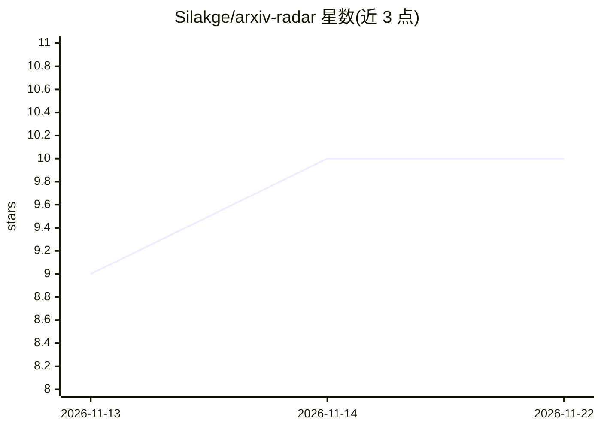

# Silakge/arxiv-radar

⭐ 10 · HTML · MIT · 推送 2026-11-20 · [GitHub](https://github.com/Silakge/arxiv-radar) · 个人维护

**科研人员的 arXiv 日报自动化工具：抓取、评分并生成订阅摘要**

一个 CLI 加 GitHub Action 组成的 arXiv 追踪工具：每日通过官方 arXiv API 抓取新提交，按关键词加权评分（标题命中×3）排序，生成 HTML/Markdown/RSS 三种格式的摘要，并用 seen.json 跨运行去重。LLM 部分可选：启用后对候选论文给出 0-10 相关性判断和一句话 TL;DR 并据此二次排序，通过 OpenAI 兼容接口接入任意 provider，密钥经环境变量读取。默认关键词模式无需 API key、完全离线运行，Python ≥3.9，4 个依赖，支持 fork 后零本地部署每日定时提交摘要。

## 筛选速览

| 维度 | 判定 | 备注 |
|---|---|---|
| AI 角色 | `ai-enhanced` | 去掉 AI 部分产品仍成立 |
| 许可风险 | `permissive` | MIT |
| 部署形态 | `library` | 以包/库形式分发 |
| 模型依赖 | local-ok | 支持本地模型 |
| 硬件要求 | — | 无带数字的原话,不猜 |
| 安装摩擦 | `low` | 无编译、无系统依赖或容器化 |
| 成熟度 | — | 结构信号不足 |

## 能力要点

- 默认透明关键词评分模式，无需 API key、完全离线
- 可选 LLM pass：0-10 相关性判断加一句话 TL;DR 并重排
- GitHub Action fork-and-forget，每日 08:00 UTC 定时生成
- HTML/Markdown/RSS 三种自包含输出格式

## 适用场景

- 每天自动收到自己研究方向的 arXiv 新论文摘要
- 零配置在 GitHub 上托管个人文献雷达，无需本地环境
- 为两个研究项目分别跑不同关键词配置的 radar
- 通过 RSS 阅读器订阅自己的论文日报

## 场景标签

`科研工具` · 领域:学习与行业

## 证据(README 行号)

> L22: part — fetch → filter → rank → format — every single morning, using either
> L23: transparent keyword scoring (no API key, no cost) or an optional LLM pass
> L42: |🔑 **No API key required**|Transparent keyword scoring is fully offline. Add an LLM pass only if you want TL;DRs|
> L146: **Does it work without an LLM?** Yes — that's the default. Keyword scoring is

## 星数曲线

2026-11-13 9 → 2026-11-22 10（+1）

---
*卡片 v1 · prompt 1.4 · 生成 2026-11-20 · 置信度 high · 依据 README sha `082d50410443` · [字段定义](../../DATASET.md)*
