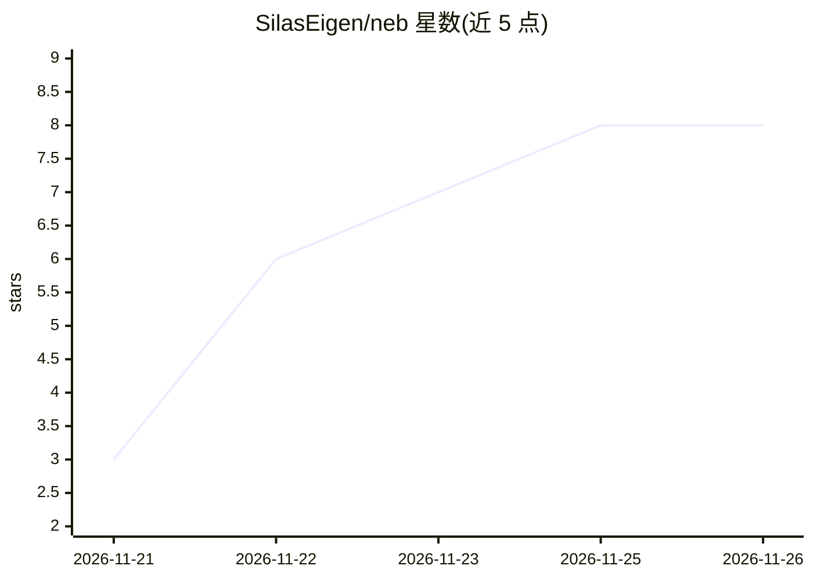

# SilasEigen/neb

⭐ 8 · Rust · Apache-2.0 · 推送 2026-11-25 · [GitHub](https://github.com/SilasEigen/neb) · [官网](https://neuralenginebyte.org) · 个人维护

**用神经网络训练步骤作工作量证明的加密货币**

NEB 是一条工作量证明的 layer-1 区块链：每次挖矿尝试是对链自有小型卷积网络（4-bit 权重）的一次确定性整数训练步，梯度摘要即出块票据，各节点的 share 汇总后更新链上模型，验证靠节点重放、无零知识证明与可信第三方。训练数据为 NASA 系外行星档案（Kepler）与 TESS 光变曲线信号，主网自第一个块起同时训练两个模型。货币层为 UTXO、Ed25519、BLAKE3，无虚拟机。提供 Windows/Linux 预编译包、Docker 与 Rust 源码构建路径。

## 筛选速览

| 维度 | 判定 | 备注 |
|---|---|---|
| AI 角色 | `ai-enhanced` | 去掉 AI 部分产品仍成立 |
| 许可风险 | `permissive` | Apache-2.0 |
| 部署形态 | `desktop` | 安装包/桌面程序 |
| 模型依赖 | — | README 未给出锁定关系 |
| 硬件要求 | — | 无带数字的原话,不猜 |
| 安装摩擦 | `low` | 无编译、无系统依赖或容器化 |
| 成熟度 | — | 结构信号不足 |

## 能力要点

- 训练步即挖矿证明，节点以重放方式验证（单次尝试约 2 ms 单核 CPU）
- 链上模型用公开科学数据训练：Kepler 系外行星信号与 TESS 光变曲线
- 60 秒出块目标（ASERT 难度调整），UTXO 货币层无虚拟机
- 提供 CPU/GPU 挖矿程序、钱包与节点，发布档案带 GPG 签名与 SHA256 校验

## 适用场景

- 运行节点并贡献算力参与以训练换算力的挖矿
- 研究确定性整数运算训练与工作量证明的结合机制
- 在公开天文数据上随链积累训练出的分类模型

## 场景标签

`模型训练` · 领域:训练与推理

## 证据(README 行号)

> L3: NEB (Neural Engine Byte) is a proof-of-work cryptocurrency where mining trains a neural network. Every mining attemp
> L29: NEB's innovation lies in the protocol-level integration of deterministic neural network training with proof of work
> L83: Mined coins are spendable after 100 blocks. The GPU miner needs an NVIDIA GPU of compute capability 7.5 or later an

## 星数曲线

2026-11-21 3 → 2026-11-26 8（+5）

---
*卡片 v1 · prompt 1.4 · 生成 2026-11-22 · 置信度 high · 依据 README sha `336f519d9fe9` · [字段定义](../../DATASET.md)*
