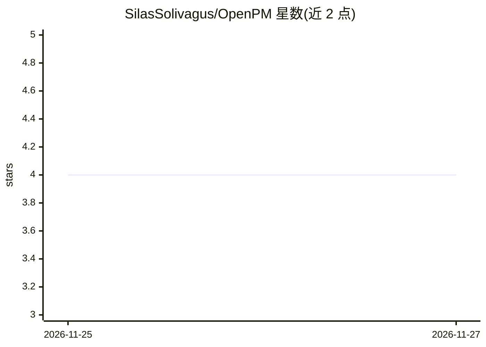

# SilasSolivagus/OpenPM

⭐ 4 · HTML · MIT · 推送 2026-11-26 · [GitHub](https://github.com/SilasSolivagus/OpenPM) · [官网](https://silassolivagus.github.io/OpenPM/) · 个人维护 · 中文 README

**把产品想法编译成流程图+可点原型+PRD 单页 HTML 的规范工作台**

面向产品经理的规格工作台：将粗略产品想法编译为一个离线单文件 HTML，流程图、可点原型与逻辑规格在同一屏幕联动，支持点击规格卡片连线到对应控件。通过 Claude Code、Cursor 等 AI 编码 agent 以自然语言驱动 6+1 确定性流水线（拉取 Wiki、起草 PRD、生成线框、构建流程画布、编译 walkthrough、推送 Wiki）。仅用 Python 3 标准库，零遥测；支持 @Component 点评、冲突拦截、v1/v2 回滚快照与 Word/Confluence/WeCom/飞书一键导出。

## 筛选速览

| 维度 | 判定 | 备注 |
|---|---|---|
| AI 角色 | `ai-native` | 本体是模型或模型工具 |
| 许可风险 | `permissive` | MIT |
| 部署形态 | `None` |  |
| 模型依赖 | — | README 未给出锁定关系 |
| 硬件要求 | — | 无带数字的原话,不猜 |
| 安装摩擦 | `low` | 无编译、无系统依赖或容器化 |
| 成熟度 | — | 结构信号不足 |

## 能力要点

- 单文件离线 HTML：流程图、可点原型、逻辑规格三栏联动
- @Component 点击点评与多评审冲突拦截、surgical 局部写回
- 6+1 确定性流水线脚本，仅依赖 Python 3 标准库
- 一键导出 Word/Confluence/WeCom/飞书，零遥测本地运行

## 适用场景

- 从零起草新功能的 PRD 与可点线框原型
- 把现有 Wiki 文档升级为新需求并只高亮增量改动
- 合并工程与 QA 的 .jsonl 评审意见并自动检测冲突
- 评审定稿后一键推送到 Confluence/WeCom/飞书

## 场景标签

 · 领域:产品管理/需求文档工具

## 证据(README 行号)

> L6:  Python 3 Stdlib Only
> L24: OpenPM compiles rough ideas into **one standalone offline HTML file where Flowchart, Clickable Prototype, and Logic
> L85: 1. **`01-pull-wiki`**: Pulls existing Wiki / WeCom / Feishu pages into `history/prd-remote.md` and `history/pull-di

## 星数曲线

2026-11-25 4 → 2026-11-27 4（+0）

---
*卡片 v1 · prompt 1.4 · 生成 2026-11-24 · 置信度 high · 依据 README sha `3673071a68e7` · [字段定义](../../DATASET.md)*
