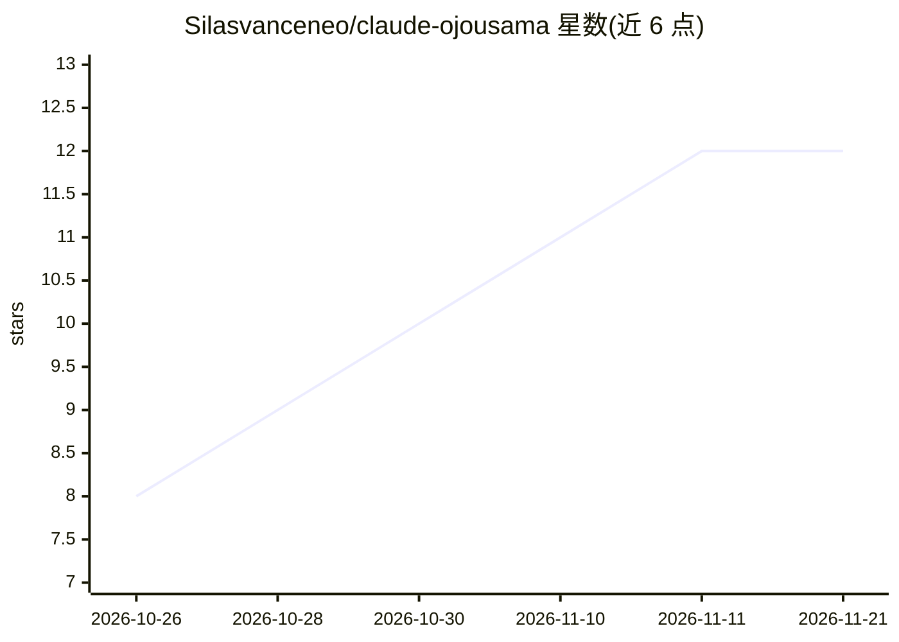

# Silasvanceneo/claude-ojousama

⭐ 12 · JavaScript · MIT · 推送 2026-10-26 · [GitHub](https://github.com/Silasvanceneo/claude-ojousama) · 个人维护 · 中文 README

**Windows/macOS/Linux 像素风 AI 桌宠：看屏幕、主动帮忙、记习惯**

基于 Electron 的桌面陪伴应用，角色为像素风程序员少女，常驻任务栏。核心机制：截图当前窗口（长边≤1280px）连同本地 OCR 文字交给所配置的模型后端（Codex 或 DeepSeek Harness），由 Agent 读写文件、执行任务、记待办；具备触发式主动帮忙（报错/复制/久坐等）、带重要度的长期记忆与后台记忆整理、经验值升级解锁、待办便签拖放、47 个动作动画等。后端任务有每日次数上限，隐私提供排除名单与逐项权限控制。安装包经 Releases 分发，也可 Node.js 22.12+ 源码运行。

## 筛选速览

| 维度 | 判定 | 备注 |
|---|---|---|
| AI 角色 | `ai-native` | 本体是模型或模型工具 |
| 许可风险 | `permissive` | MIT |
| 部署形态 | `desktop` | 安装包/桌面程序 |
| 模型依赖 | locked-api |  |
| 硬件要求 | — | 无带数字的原话,不猜 |
| 安装摩擦 | `medium` | 含编译或系统依赖之一 |
| 成熟度 | — | 结构信号不足 |

## 能力要点

- 窗口截图+本地 OCR 交给模型，报错时主动提供救援
- 基于 Codex App Server / DeepSeek Harness 双后端的 Agent（读写文件、后台任务、目标跟进）
- 带重要度的长期记忆、后台记忆整理与成长/升级系统
- 排除名单、逐项权限开关、截图即用即删等隐私控制

## 适用场景

- 想要一个会看屏幕上下文、主动提醒报错和待办的桌面伙伴
- 让 AI 在后台整理下载文件夹、巡检工作区未提交修改
- 用番茄钟、久坐提醒和桌面便签辅助日常专注管理

## 场景标签

`AI 助手` · 领域:对话与助手

## 证据(README 行号)

> L15: 她不只是会动的贴图。她背后是一个真正的 AI Agent：能读写文件、跑命令、做调研。她会自己留意你在做什么：屏幕上出现报错时拿着放大镜过来问要不要帮忙，提醒你没理就过几分钟再来，你复制了一段英文就问要不要翻译，下载文件夹乱了就把
> L21: |👀 **真的会看屏幕**|把你正在用的窗口截图（长边不超过 1280px），连同本地 OCR 识别出的文字一起交给模型看。她能指出代码里的 bug、点评你在看的东西，或者把屏幕上的截止时间记成待办。|
> L100: - **Windows 默认使用 DeepSeek Harness**：先安装并配置好 DSH 桌面版，也可以在设置中切换为 Codex。

## 星数曲线

2026-10-26 8 → 2026-11-21 12（+4）

---
*卡片 v1 · prompt 1.4 · 生成 2026-11-18 · 置信度 high · 依据 README sha `4b0894a34d7b` · [字段定义](../../DATASET.md)*
