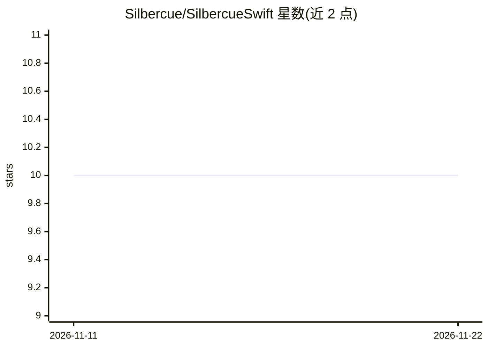

# Silbercue/SilbercueSwift

⭐ 10 · Swift · MIT · 推送 2026-08-27 · [GitHub](https://github.com/Silbercue/SilbercueSwift) · [官网](https://second-truth.com/) · 个人维护

**iOS 开发 MCP 服务器：为 AI agent 提供构建、测试与 UI 自动化工具**

以单个 Swift 二进制形式分发的 iOS 开发 MCP 服务器，提供 58 个工具（免费版 49 个），覆盖 xcodebuild 构建、模拟器管理、基于 WebDriverAgent 的 UI 自动化、xcresult 结构化解析（失败信息含 file:line 与截图）、代码覆盖率、日志采集等。面向 Claude Code、Cursor 及任意支持 stdio MCP 的客户端，解决 agent 需解析原始构建日志的问题。通过 Homebrew 安装，也可从源码编译；Pro 版为 12 EUR/月的订阅，增加 9 个工具与更低延迟。

## 筛选速览

| 维度 | 判定 | 备注 |
|---|---|---|
| AI 角色 | `ai-ecosystem` | LLM/agent 周边工具 |
| 许可风险 | `permissive` | MIT |
| 部署形态 | `None` |  |
| 模型依赖 | — | README 未给出锁定关系 |
| 硬件要求 | — | 无带数字的原话,不猜 |
| 安装摩擦 | `medium` | 含编译或系统依赖之一 |
| 成熟度 | — | 结构信号不足 |

## 能力要点

- 单个 8.5MB 原生 Swift 二进制，无 Node.js/Appium/Python 依赖
- 解析 .xcresult 包，返回结构化测试结果、失败截图与逐文件覆盖率
- 16 个 UI 自动化工具，含 run_plan 多步批量执行与批量弹窗处理
- 14 个类别的 58 个工具：构建、测试、模拟器管理、日志、截图

## 适用场景

- 在 Claude Code / Cursor 中让 agent 构建、测试并操作 iOS 模拟器
- 让 agent 读取结构化的测试失败信息与失败截图进行诊断
- 用 agent 执行批量 UI 自动化脚本与多设备检查（Dark Mode、iPad 等）
- 采集并按主题过滤应用日志，减少 agent 上下文 token 消耗

## 场景标签

`GUI 自动化` · 领域:效率与自动化

## 证据(README 行号)

> L10: SilbercueSwift MCP server
> L16: Built for Claude Code, Cursor, and any MCP-compatible AI agent.
> L22: Every iOS MCP server has the same problem: **raw xcodebuild output is useless for AI agents.** 500 lines of build l

## 星数曲线

2026-11-11 10 → 2026-11-22 10（+0）

---
*卡片 v1 · prompt 1.4 · 生成 2026-11-20 · 置信度 high · 依据 README sha `ac386968eef4` · [字段定义](../../DATASET.md)*
