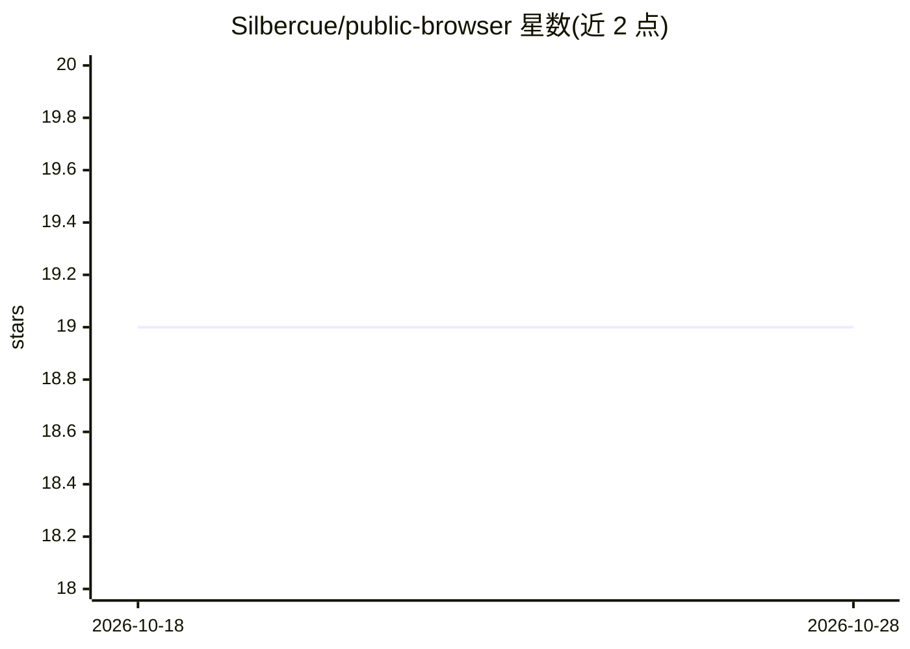

# Silbercue/public-browser

⭐ 19 · TypeScript · MIT · 推送 2026-10-22 · [GitHub](https://github.com/Silbercue/public-browser) · [官网](https://www.npmjs.com/package/public-browser) · 个人维护

**让 Claude Code/Cursor 等 MCP 客户端驱动 Chrome 的 MCP 服务器**

通过 Chrome DevTools Protocol 直连 Chrome 的 MCP 服务器，供 Claude Code、Cursor、Cline 及任意 stdio MCP 客户端使用。核心机制：view_page 返回带稳定 e-ref 的无障碍树、run_plan 在单次调用中执行带变量与条件的多步动作、响应只返回 DOM diff 以减少 token。选择器歧义、过期 ref、未确认拖拽等场景返回显式失败信息；支持嵌套跨域 iframe 与 shadow DOM。另提供无 LLM 的接入方式：Node 库与 Python 客户端（pip 安装），可用于决策模型 Jev 的循环。限制：profile 模式在 macOS 上不携带站点登录态。

## 筛选速览

| 维度 | 判定 | 备注 |
|---|---|---|
| AI 角色 | `ai-ecosystem` | LLM/agent 周边工具 |
| 许可风险 | `permissive` | MIT |
| 部署形态 | `library` | 以包/库形式分发 |
| 模型依赖 | — | README 未给出锁定关系 |
| 硬件要求 | — | 无带数字的原话,不猜 |
| 安装摩擦 | `low` | 无编译、无系统依赖或容器化 |
| 成熟度 | — | 结构信号不足 |

## 能力要点

- 直连 CDP，无 Playwright 依赖、无扩展桥接、无逐步 shell 命令
- run_plan 单次调用执行含变量与条件的多步动作，响应以 DOM diff 呈现
- e-ref 跨调用缓存，支持嵌套跨域 iframe 与开放/闭合 shadow DOM
- 无 LLM 接入路径：Node 库 createSession() 与 Python 客户端

## 适用场景

- 在 Claude Code/Cursor 中让 AI 助手操作网页、填表、读取页面内容
- 以较少 token 完成浏览器自动化任务（run_plan 合并多步）
- 用 Python/Node 脚本驱动同一套工具处理器，接入决策模型做自动化循环

## 场景标签

`浏览器自动化` · 领域:效率与自动化

## 证据(README 行号)

> L9: Lets Claude Code, Cursor and any MCP client drive Chrome. In a blind benchmark on a 30-test page, five runs each, Pu
> L13: > **Looking for an alternative to agent-browser, Playwright MCP, Chrome DevTools MCP or Browser MCP?** Public Brows

## 星数曲线

2026-10-18 19 → 2026-10-28 19（+0）

---
*卡片 v1 · prompt 1.4 · 生成 2026-10-28 · 置信度 high · 依据 README sha `e648e5efa8b5` · [字段定义](../../DATASET.md)*
