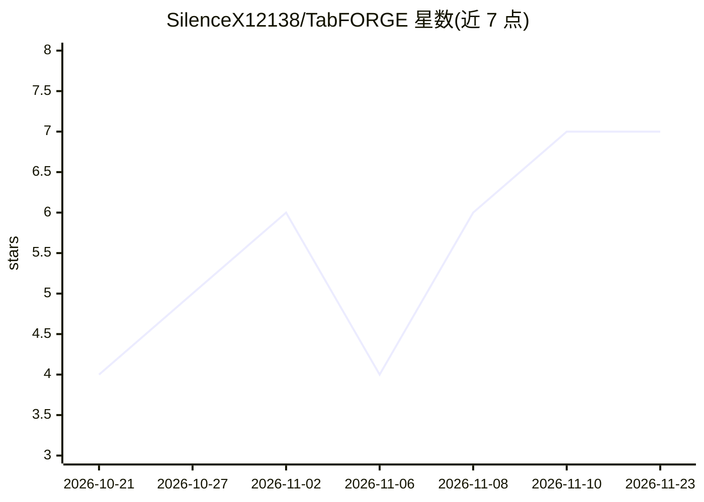

# SilenceX12138/TabFORGE

⭐ 7 · Python · Apache-2.0 · 推送 2026-11-18 · [GitHub](https://github.com/SilenceX12138/TabFORGE) · [官网](https://silencex12138.github.io/TabFORGE/) · 组织维护

**面向研究者的表格基础模型库：生成/分类/回归等七任务统一接口**

NeurIPS 2026 论文的官方实现：一个表格基础模型，由 Structure-aware Feature Encoder、Score-based Diffusion Transformer 与 Denoising-aligned Latent Decoder 组成，学习混合类型表格的上下文表示。以 PyPI 包 tabforge-ml 发布，提供统一 estimator API，支持 pandas/NumPy 输入与 schema 感知处理；默认使用 Hugging Face 上的预训练权重（首次使用时下载），也可从零训练或加载骨干 checkpoint；支持 CPU mock 嵌入、单设备与 torchrun 分布式执行，教程以 Colab notebook 提供。

## 筛选速览

| 维度 | 判定 | 备注 |
|---|---|---|
| AI 角色 | `ai-native` | 本体是模型或模型工具 |
| 许可风险 | `permissive` | Apache-2.0 |
| 部署形态 | `library` | 以包/库形式分发 |
| 模型依赖 | — | README 未给出锁定关系 |
| 硬件要求 | — | 无带数字的原话,不猜 |
| 安装摩擦 | `low` | 无编译、无系统依赖或容器化 |
| 成熟度 | — | 结构信号不足 |

## 能力要点

- 一个 estimator 接口覆盖生成、分类、回归、嵌入、填补、聚类、异常检测
- 预训练权重托管于 Hugging Face，首次使用自动下载
-  EDM preconditioning 的潜扩散与 Euler/Heun 采样
- CPU mock 嵌入示例与 torchrun 分布式执行支持

## 适用场景

- 为表格数据生成合成样本并配合 TabEval 做评估
- 在表格数据上做分类/回归/异常检测等监督任务
- 提取防泄漏的折外嵌入用于下游训练
- 离线或从零训练完整模型组件

## 场景标签

`模型训练` `数据分析` · 领域:效率与自动化

## 证据(README 行号)

> L29: Its estimator API supports synthetic data generation, classification,
> L30: regression, embedding, imputation, clustering, and anomaly detection.
> L42: - Pretrained TabFORGE model and

## 星数曲线

2026-10-21 4 → 2026-11-23 7（+3）

---
*卡片 v1 · prompt 1.4 · 生成 2026-11-20 · 置信度 high · 依据 README sha `e30a0336d1f2` · [字段定义](../../DATASET.md)*
