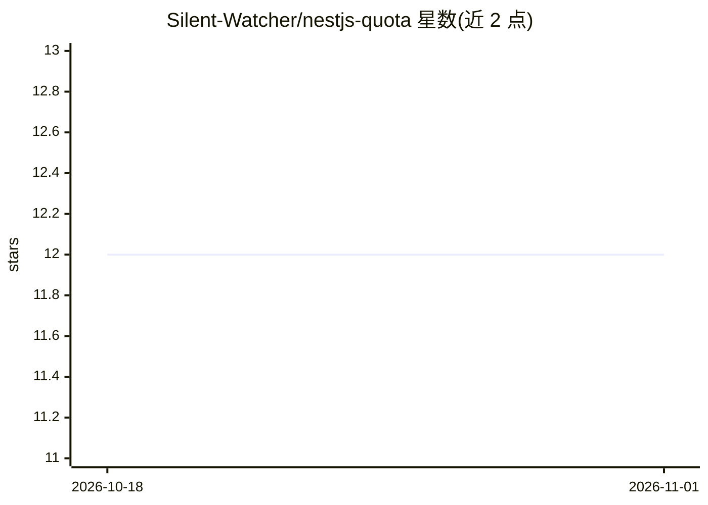

# Silent-Watcher/nestjs-quota

⭐ 12 · TypeScript · MIT · 推送 2026-09-28 · [GitHub](https://github.com/Silent-Watcher/nestjs-quota) · [官网](https://www.npmjs.com/package/nestjs-quota) · 个人维护

**NestJS 的 API 配额执行与用量计量库，支持多策略原子扣减**

面向 NestJS 开发者的配额/用量计量引擎：多作用域策略（用户/租户/全局）一次性原子检查与扣减，支持幂等重试防双重计费、hold/commit/release 预留机制（适用于先占额后结算真实 token 成本的 LLM 调用）、后置计量拦截器。核心包零运行时依赖、框架无关，可插拔存储（内存/Redis，Redis 用 Lua 脚本保证原子性），不强制 ORM 或数据库。限制：仅支持固定窗口、预留单策略。

## 筛选速览

| 维度 | 判定 | 备注 |
|---|---|---|
| AI 角色 | `ai-enhanced` | 去掉 AI 部分产品仍成立 |
| 许可风险 | `permissive` | MIT |
| 部署形态 | `library` | 以包/库形式分发 |
| 模型依赖 | — | README 未给出锁定关系 |
| 硬件要求 | — | 无带数字的原话,不猜 |
| 安装摩擦 | `low` | 无编译、无系统依赖或容器化 |
| 成熟度 | — | 结构信号不足 |

## 能力要点

- 多策略配额原子检查与扣减（任一超限则全部不扣）
- 幂等键重试防止双重计费（冲突抛 IdempotencyConflictError）
- 预留机制：先占额度，操作完成后 commit/release 对账
- Redis 存储以 Lua 脚本服务端原子执行，无 GET-then-SET 竞态

## 适用场景

- 按免费/专业套餐限制租户的月度 API 调用量
- 对 LLM 调用先预留 token 额度、完成后按真实成本对账
- 客户端超时重试时避免重复扣减配额
- 多进程/多服务器共享配额状态（Redis 存储）

## 场景标签

 · 领域:后端/API 治理

## 证据(README 行号)

> L24: - "Can we hold capacity for an in-flight LLM call before we know its real
> L160: const { handle } = await quotaService.reserve({ policy: 'llm-monthly-tokens', subject: 'tenant_123' }, {}, /* leas
> L3: Production-grade **API quota enforcement** and **usage metering** for

## 星数曲线

2026-10-18 12 → 2026-11-01 12（+0）

---
*卡片 v1 · prompt 1.4 · 生成 2026-11-01 · 置信度 mid · 依据 README sha `dad554c61ab7` · [字段定义](../../DATASET.md)*
