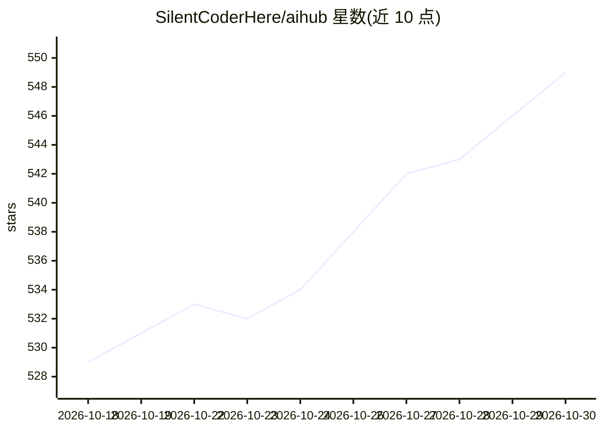

# SilentCoderHere/aihub

⭐ 549 · Kotlin · GPL-3.0 · 推送 2026-10-19 · [GitHub](https://github.com/SilentCoderHere/aihub) · 个人维护

**安卓聚合多 AI 助手的标签页客户端，隐私优先**

Kotlin 编写的 Android 应用，通过 webview 将多个 AI 助手服务聚合在单一标签页界面中，支持重排、隐藏或禁用各个助手，会话可跨应用重启持久化，并可后台运行。默认基于 StevenBlack hosts 列表屏蔽广告与追踪器，域名列表由 GitHub Action 自动更新。声明零数据收集，无分析、遥测或崩溃上报。通过 F-Droid、OpenAPK、GitHub Releases 与 Obtainium 分发，GPL v3 许可，由个人开发者维护。

## 筛选速览

| 维度 | 判定 | 备注 |
|---|---|---|
| AI 角色 | `ai-ecosystem` | LLM/agent 周边工具 |
| 许可风险 | `viral` | GPL-3.0 |
| 部署形态 | `None` |  |
| 模型依赖 | — | README 未给出锁定关系 |
| 硬件要求 | — | 无带数字的原话,不猜 |
| 安装摩擦 | `low` | 无编译、无系统依赖或容器化 |
| 成熟度 | — | 结构信号不足 |

## 能力要点

- 标签页聚合多个 AI 助手，支持重排/隐藏/禁用
- 会话持久化，跨应用重启保留
- 默认用 StevenBlack hosts 列表屏蔽广告与追踪器
- 声明零数据收集，无遥测与分析

## 适用场景

- 在手机上一个应用内切换使用多个 AI 助手
- 避免为每个 AI 服务单独安装应用
- 在屏蔽追踪器的环境下访问 AI 服务

## 场景标签

`AI 助手` · 领域:对话与助手

## 证据(README 行号)

> L4:  All your AI assistants, beautifully together.
> L30: - 📱 **Smooth tabbed browsing** – persistent sessions with background support

## 星数曲线

2026-10-18 529 → 2026-10-30 549（+20）

---
*卡片 v1 · prompt 1.4 · 生成 2026-10-21 · 置信度 high · 依据 README sha `d2503fa43a96` · [字段定义](../../DATASET.md)*
