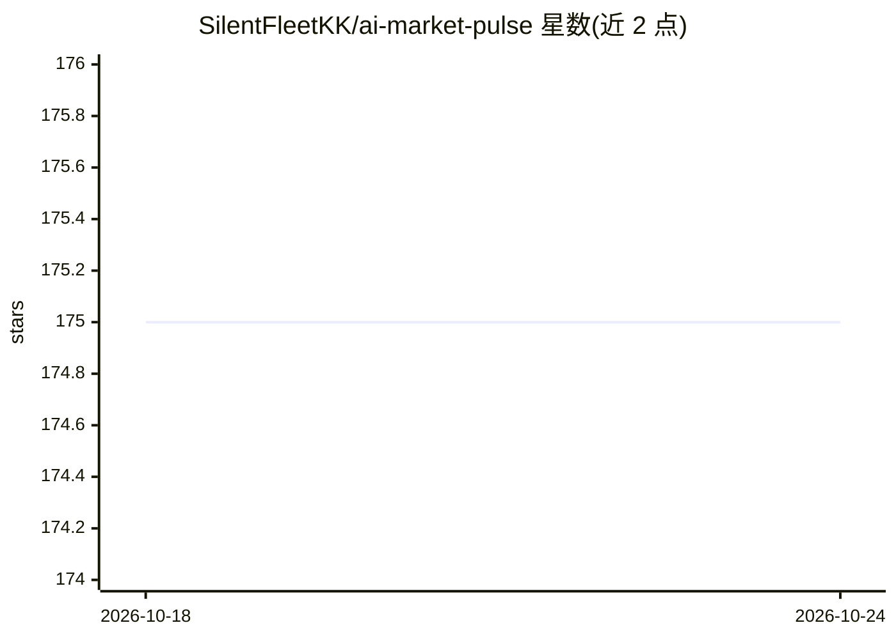

# SilentFleetKK/ai-market-pulse

⭐ 175 · Python · MIT · 推送 2026-07-11 · [GitHub](https://github.com/SilentFleetKK/ai-market-pulse) · 个人维护 · 中文 README

**自选股量化研究工具：生成每日 AI 市场研究报告与看板**

面向量化交易研究流程的命令行与本地控制台工具：输入自选股或持仓，计算技术因子、规则优先的信号评分、基准相对强弱、组合归因与风险提示，生成 Markdown/HTML/JSON 报告、Web 仪表盘与双语静态站点，可经 GitHub Pages 无服务器日更发布。数据源默认 yfinance，可配 AkShare/Baostock/Tushare 按序回退。AI 功能为可选：OpenAI 兼容的摘要、截图转持仓、报告问答，--no-ai 可关闭；不连接券商、不下单。

## 筛选速览

| 维度 | 判定 | 备注 |
|---|---|---|
| AI 角色 | `ai-enhanced` | 去掉 AI 部分产品仍成立 |
| 许可风险 | `permissive` | MIT |
| 部署形态 | `self-host` | docker 或自建部署 |
| 模型依赖 | — | README 未给出锁定关系 |
| 硬件要求 | — | 无带数字的原话,不猜 |
| 安装摩擦 | `low` | 无编译、无系统依赖或容器化 |
| 成熟度 | — | 结构信号不足 |

## 能力要点

- 技术因子快照（均线/RSI/MACD/布林/ATR 等）与 0-100 规则优先评分
- 组合模式含持仓数量、成本、当日与未实现盈亏及归因
- 数据源注册表按序回退：yfinance 默认，可选 AkShare/Baostock/Tushare
- 阈值告警推送 Telegram/Slack/Discord/飞书/企微/webhook/邮件

## 适用场景

- 每日自动生成自选股的研究报告并发布静态站点
- 检查持仓组合的风险、归因与相对基准强弱
- 用 AI 转录券商截图快速录入持仓

## 场景标签

`金融量化` · 领域:学习与行业

## 证据(README 行号)

> L13: AI Market Pulse is not just a scheduled stock script. It turns daily market data into a quant-oriented research pro
> L202: market-pulse run --config watchlist.yaml --output reports --no-ai

## 星数曲线

2026-10-18 175 → 2026-10-24 175（+0）

---
*卡片 v1 · prompt 1.4 · 生成 2026-10-22 · 置信度 high · 依据 README sha `9de57541843c` · [字段定义](../../DATASET.md)*
