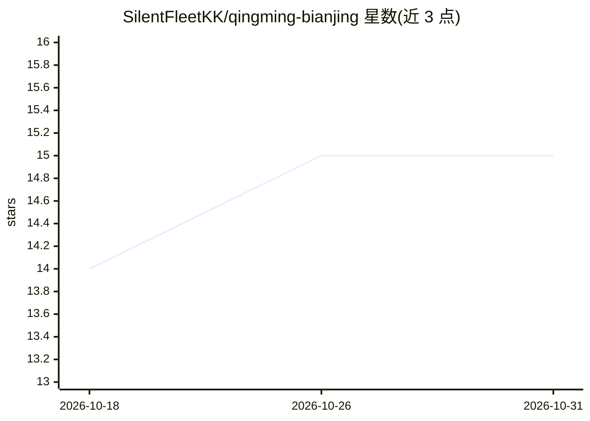

# SilentFleetKK/qingming-bianjing

⭐ 15 · HTML · 推送 2026-09-23 · [GitHub](https://github.com/SilentFleetKK/qingming-bianjing) · [官网](https://silentfleetkk.github.io/qingming-bianjing/) · 个人维护 · 中文 README

**同一提示词下两个大模型生成汴京实时 3D 网页的对比测评仓库**

将同一份约五千字的提示词分别交给 Claude Opus 5.5 与 GPT 6 Sol，由两个模型各自从零写出可在浏览器中实时浏览的北宋汴京三维城市页面，作为大模型生成能力的对比测评。两个版本均为单 HTML 文件，建筑、虹桥、漕船、人群等全部程序化生成，无外部图片与模型。提供在线预览与本地网页服务器运行方式；项目自身许可证尚待确定。

## 筛选速览

| 维度 | 判定 | 备注 |
|---|---|---|
| AI 角色 | `ai-ecosystem` | LLM/agent 周边工具 |
| 许可风险 | `none` | — |
| 部署形态 | `None` |  |
| 模型依赖 | — | README 未给出锁定关系 |
| 硬件要求 | — | 无带数字的原话,不猜 |
| 安装摩擦 | `low` | 无编译、无系统依赖或容器化 |
| 成熟度 | — | 结构信号不足 |

## 能力要点

- 同一提示词、两个模型各自从零生成单文件实时 3D 汴京页面
- Opus 5.5 版约 2,700 行，含 600+ 实例化行人、三种氛围切换、展卷巡游
- 全部几何与动画程序化生成，运行时不请求第三方服务器
- 记录两版本的生成过程与代码出处（参考宝玉的测评形式）

## 适用场景

- 对比两个大模型从零生成复杂 3D 网页的能力
- 在浏览器中浏览程序化生成的《清明上河图》汴京场景
- 复用提示词与测评形式做其他大模型生成测评

## 场景标签

`模型评测` · 领域:评测与运维

## 证据(README 行号)

> L19: 这个仓库把**同一份约五千字的提示词**分别交给 **Claude Opus 5.5** 和 **GPT 6 Sol**，让它们各自从零写出一座可以走进去的汴京。
> L84: - 两个版本使用同一份提示词：清明上河图-汴京-提示词.md。
> L112: **Same prompt, two cities.** Two language models — **Claude Opus 5.5** and **GPT 6 Sol** — were each given the sam

## 星数曲线

2026-10-18 14 → 2026-10-31 15（+1）

---
*卡片 v1 · prompt 1.4 · 生成 2026-10-30 · 置信度 high · 依据 README sha `851435b702d1` · [字段定义](../../DATASET.md)*
