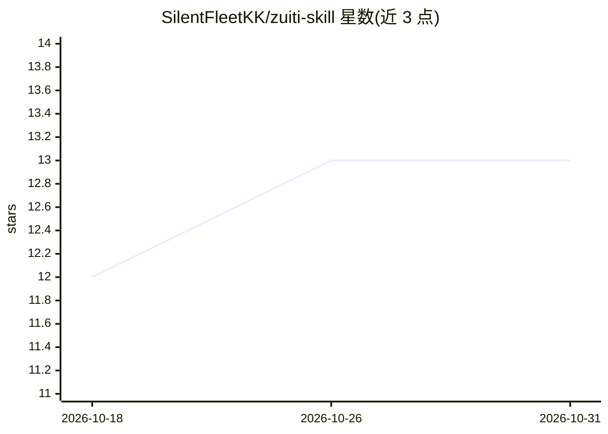

# SilentFleetKK/zuiti-skill

⭐ 13 · Python · MIT · 推送 2026-07-08 · [GitHub](https://github.com/SilentFleetKK/zuiti-skill) · 个人维护 · 中文 README

**难回消息的"嘴替"Agent Skill：潜台词翻译+三档回复**

面向日常沟通困境用户的 Agent Skill（SKILL.md 资产），适配 Claude Code / Codex / Cursor 等 runtime。用户把收到的难回消息贴给 agent，skill 驱动其输出五段固定结构：潜台词翻译、误读风险标注、体面/绵里藏针/掀桌三档可直接发送的回复、长期策略与发送建议。支持从用户聊天记录蒸馏个人说话风格生成专属嘴替；提供画饼/催婚/甲方三个可独立安装的场景包子仓库。安装方式含 npx skills add、让 agent 代装或直接粘贴单文件精简版。内置安全边界规则，声明不做人身攻击、不替用户决定忍或撕。

## 筛选速览

| 维度 | 判定 | 备注 |
|---|---|---|
| AI 角色 | `ai-native` | 本体是模型或模型工具 |
| 许可风险 | `permissive` | MIT |
| 部署形态 | `library` | 以包/库形式分发 |
| 模型依赖 | — | README 未给出锁定关系 |
| 硬件要求 | — | 无带数字的原话,不猜 |
| 安装摩擦 | `low` | 无编译、无系统依赖或容器化 |
| 成熟度 | — | 结构信号不足 |

## 能力要点

- 五段固定输出：潜台词翻译、误读风险、三档回复、长期策略、发送建议
- 从聊天记录蒸馏个人口吻，生成存于 zuiti-personas/ 的专属 skill
- 画饼/催婚/甲方三个独立场景包，各带触发词与一键安装命令
- 可脱离 runtime 以单文件 zuiti-lite.md 粘贴进任意 AI 对话框使用

## 适用场景

- 遇到老板派活、朋友催债等难回消息时，拿到可直接发送的分档回复
- 识别对方消息背后的潜台词并评估误读风险
- 让 AI 用我自己的说话风格替我组织回复

## 场景标签

`AI 写作` `提示工程` · 领域:Agent 开发

## 证据(README 行号)

> L10: Agent Skills
> L186: **① 让 agent 代劳**（最省事）——在 Claude Code / Codex / Cursor / OpenClaw 里对它说一句：
> L214: 1. **潜台词翻译**：对方表面说什么，真实想推进什么。

## 星数曲线

2026-10-18 12 → 2026-10-31 13（+1）

---
*卡片 v1 · prompt 1.4 · 生成 2026-10-31 · 置信度 mid · 依据 README sha `3c68fb183f02` · [字段定义](../../DATASET.md)*
