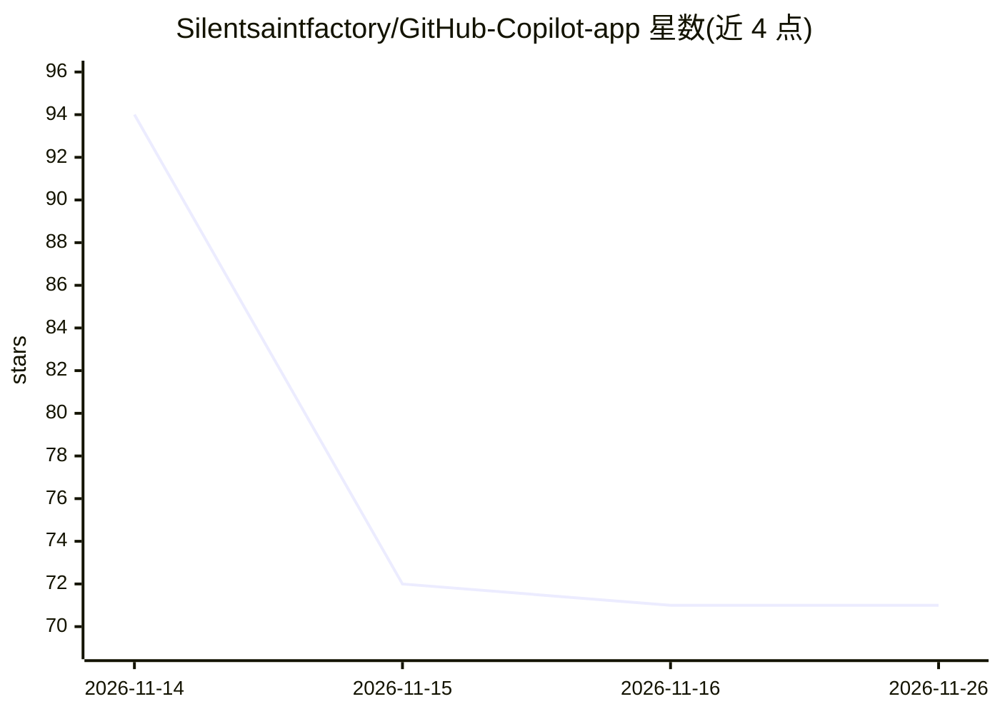

# Silentsaintfactory/GitHub-Copilot-app

⭐ 71 · Apache-2.0 · 推送 2026-11-15 · [GitHub](https://github.com/Silentsaintfactory/GitHub-Copilot-app) · 组织维护

**管理 GitHub 仓库软件工作的 agent 桌面客户端**

面向 GitHub 仓库的 agent 桌面应用：单一控制中心内查找待办工作、启动与引导 agent、审查进度并落地变更，覆盖从想法到 pull request 的流程。每个本地会话运行在独立 git worktree，云端会话在 GitHub 托管的隔离环境中运行。提供 Canvas 可视化 agent 工作面、My Work 汇总会话/issue/PR、Automations 定时任务与 Agent Merge 辅助合并。需 Git 与 Copilot 订阅，或自带模型 key（BYOK）。以各平台安装包分发，仓库声明版权归 GitHub, Inc。

## 筛选速览

| 维度 | 判定 | 备注 |
|---|---|---|
| AI 角色 | `ai-ecosystem` | LLM/agent 周边工具 |
| 许可风险 | `permissive` | Apache-2.0 |
| 部署形态 | `desktop` | 安装包/桌面程序 |
| 模型依赖 | — | README 未给出锁定关系 |
| 硬件要求 | — | 无带数字的原话,不猜 |
| 安装摩擦 | `low` | 无编译、无系统依赖或容器化 |
| 成熟度 | — | 结构信号不足 |

## 能力要点

- 本地会话运行于独立 git worktree，支持并行 agent 开发
- Canvas 将 agent 计划、终端、diff 与工作流状态呈现为可编辑界面
- Automations 将重复提示与工作流转为定时/后台任务
- 支持 BYOK 自带模型 provider，无 Copilot 订阅也可使用

## 适用场景

- 在多个仓库间并行运行和管理 agent 开发任务
- 以可视化界面审查并引导 agent 的工作进度
- 将重复性开发流程设为定时或后台自动化任务

## 场景标签

`编码 Agent` `工作流自动化` · 领域:效率与自动化

## 证据(README 行号)

> L13: The GitHub Copilot app is an agent-native desktop experience for managing software work from idea to pull request. 
> L15: The app is built for parallel agent-driven development. Each local session runs in its own isolated git worktree, a

## 星数曲线

2026-11-14 94 → 2026-11-26 71（-23）

---
*卡片 v1 · prompt 1.4 · 生成 2026-11-18 · 置信度 mid · 依据 README sha `b87d21cbdb86` · [字段定义](../../DATASET.md)*
