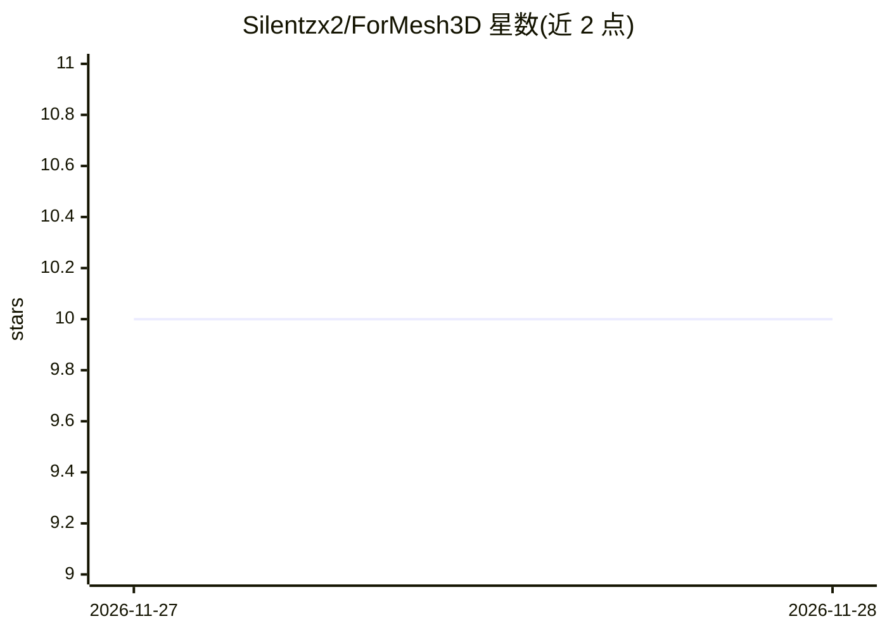

# Silentzx2/ForMesh3D

⭐ 10 · TypeScript · NOASSERTION · 推送 2026-11-27 · [GitHub](https://github.com/Silentzx2/ForMesh3D) · 个人维护

**自托管 AI 3D 资产工作室：图像生成与网格处理流水线**

ForMesh3D 将图像到 3D 生成与网格生产工具整合到一个本地工作区，由 Next.js 前端、FastAPI 后端、模型推理适配器和持久化工作区/任务层组成，可在本机或 VPS 上运行。模型通过 backend/config/models.yaml 清单注册与启停，覆盖 Hunyuan3D、TripoSG、TripoSR、TRELLIS、Stable Fast 3D 等适配器，支持分割、重拓扑、UV 展开、自动绑定与动作生成。限制：模型权重需手动下载，配置启用不保证推理可用；GPU 推理需 NVIDIA GPU 与 CUDA 环境，CPU 模式仅用于开发与部分任务。

## 筛选速览

| 维度 | 判定 | 备注 |
|---|---|---|
| AI 角色 | `ai-native` | 本体是模型或模型工具 |
| 许可风险 | `none` | NOASSERTION |
| 部署形态 | `None` |  |
| 模型依赖 | — | README 未给出锁定关系 |
| 硬件要求 | `cpu-ok` | |
| 安装摩擦 | `medium` | 含编译或系统依赖之一 |
| 成熟度 | — | 结构信号不足 |

## 能力要点

- 图像生成 3D 网格，支持 Hunyuan3D、TripoSG、TRELLIS、Stable Fast 3D 等适配器
- 网格处理流水线：分割、重拓扑、UV 展开、自动绑定、动作生成
- GPU 推理调度器与模型适配器隔离的 worker 架构，任务状态持久化到 SQLite
- 本地 Three.js 视口检查 GLB 资产，模型启用状态由 models.yaml 控制

## 适用场景

- 在本地或 VPS 上搭建自托管的图像转 3D 资产生成工作流
- 为 3D 打印或 Blender 流程准备网格：分割、重拓扑、UV、绑定
- 用参考图或文字给现有网格生成纹理材质

## 场景标签

 · 领域:3D 资产生成/工具

## 证据(README 行号)

> L14: ForMesh3D brings image-to-3D generation and practical mesh-production tools into one local workspace. It combines a
> L24: |**Image to 3D**|Generate raw 3D geometry from a reference image with Hunyuan3D, TripoSG, and TRELLIS adapters.|

## 星数曲线

2026-11-27 10 → 2026-11-28 10（+0）

---
*卡片 v1 · prompt 1.4 · 生成 2026-11-27 · 置信度 high · 依据 README sha `62a159fd8558` · [字段定义](../../DATASET.md)*
