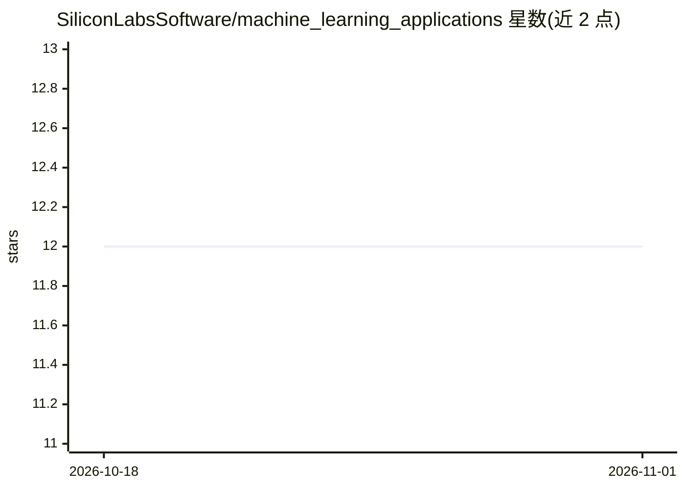

# SiliconLabsSoftware/machine_learning_applications

⭐ 12 · C · NOASSERTION · 推送 2026-10-27 · [GitHub](https://github.com/SiliconLabsSoftware/machine_learning_applications) · 组织维护

**Silicon Labs 设备的嵌入式 TinyML 应用示例合集**

Silicon Labs 维护的嵌入式机器学习应用集合，按用例类别组织，覆盖语音唤醒词等边缘 AI 场景。每个应用自包含，含模型训练源码与导出 TensorFlow Lite 等产物的文档，部分含主机侧可视化/数据采集/评估脚本。基于 TFLM 框架在 EFR32 等芯片上做推理，适配 EFR32xG24 等带硬件加速器的开发套件。提供 Docker 构建容器、Simplicity Studio 扩展与原生 CLI 三种构建烧录路径。README 声明除另行说明外示例均为实验性质，未正式测试，不适合生产环境。

## 筛选速览

| 维度 | 判定 | 备注 |
|---|---|---|
| AI 角色 | `ai-native` | 本体是模型或模型工具 |
| 许可风险 | `none` | NOASSERTION |
| 部署形态 | `self-host` | docker 或自建部署 |
| 模型依赖 | — | README 未给出锁定关系 |
| 硬件要求 | — | 无带数字的原话,不猜 |
| 安装摩擦 | `low` | 无编译、无系统依赖或容器化 |
| 成熟度 | `idea` | |

## 能力要点

- 按用例组织的自包含嵌入式 ML 应用集合
- 各应用附模型训练源码与 TFLite 导出文档
- 提供 Docker 构建容器（含 aarch64 说明）与 GoogleTest 单元测试
- 可作为 Simplicity Studio SDK 扩展加载并烧录预编译 demo

## 适用场景

- 在 Silicon Labs 开发板上运行现成的 TinyML 示例
- 以现成应用为起点开发自己的 TinyML 固件
- 用构建容器在 CI 中编译与测试嵌入式 ML 应用

## 场景标签

`模型训练` `推理引擎` · 领域:训练与推理

## 证据(README 行号)

> L3: Silicon Labs provides integrated hardware, software, and development tools to help you quickly create secure, intell
> L5: This repository contains a collection of embedded applications that leverage ML. You can use these to program your o

## 星数曲线

2026-10-18 12 → 2026-11-01 12（+0）

---
*卡片 v1 · prompt 1.4 · 生成 2026-11-01 · 置信度 high · 依据 README sha `9b5a404d1922` · [字段定义](../../DATASET.md)*
