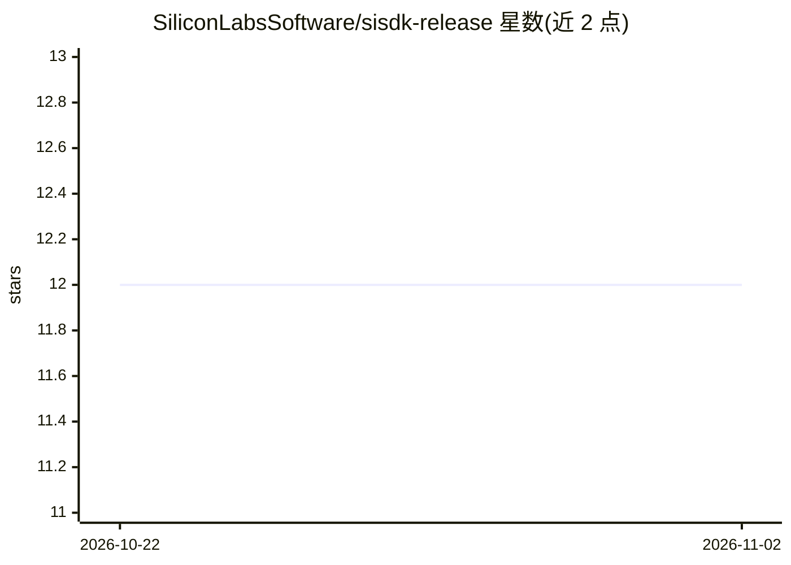

# SiliconLabsSoftware/sisdk-release

⭐ 12 · C · NOASSERTION · 推送 2026-10-14 · [GitHub](https://github.com/SiliconLabsSoftware/sisdk-release) · 组织维护

**Silicon Labs Simplicity SDK 发布镜像仓库，仅供文档链接引用**

由 Silicon Labs 发布的发布内容镜像仓库，存在目的仅是支撑公开文档 URL 对软件发布内容的源码/目录链接引用。README 明确声明开发者不应 clone、fork 或通过本仓库获取与管理 Silicon Labs 软件，且其结构、依赖与内容不保证与官方支持的分发一致。获取软件的受支持途径是 SLT-CLI（v1.1.0+）命令行工具或 Simplicity Installer（v1.1.0+）图形安装器，直接使用本仓库产生的问题不在官方支持范围内。主题标签覆盖蓝牙、Matter、Zigbee、Wi-Fi、RTOS 与 MCU 机器学习等嵌入式方向。

## 筛选速览

| 维度 | 判定 | 备注 |
|---|---|---|
| AI 角色 | `ai-enhanced` | 去掉 AI 部分产品仍成立 |
| 许可风险 | `none` | NOASSERTION |
| 部署形态 | `None` |  |
| 模型依赖 | — | README 未给出锁定关系 |
| 硬件要求 | — | 无带数字的原话,不猜 |
| 安装摩擦 | `low` | 无编译、无系统依赖或容器化 |
| 成熟度 | — | 结构信号不足 |

## 能力要点

- 仅为文档 URL 引用而发布的发布内容镜像
- 官方获取途径为 SLT-CLI / Simplicity Installer（v1.1.0+）
- README 明确声明不支持直接 clone 使用本仓库

## 适用场景

- 通过文档中的链接查看发布资产内的源码文件
- 了解 Simplicity SDK 发布内容的目录结构

## 场景标签

 · 领域:嵌入式/IoT 软件开发

## 证据(README 行号)

> L3: This GitHub repository is published by **Silicon Labs** solely to support public documentation URLs that reference s
> L5: **Developers should NOT** clone, fork, or otherwise use this repository as a means to obtain or manage Silicon Labs 

## 星数曲线

2026-10-22 12 → 2026-11-02 12（+0）

---
*卡片 v1 · prompt 1.4 · 生成 2026-11-01 · 置信度 mid · 依据 README sha `cebb4c2ff0ff` · [字段定义](../../DATASET.md)*
