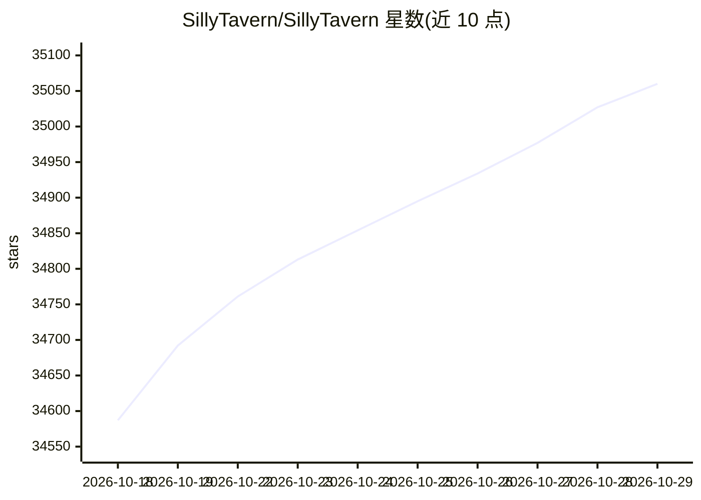

# SillyTavern/SillyTavern

⭐ 35,060 · JavaScript · AGPL-3.0 · 推送 2026-10-02 · [GitHub](https://github.com/SillyTavern/SillyTavern) · [官网](https://sillytavern.app) · 组织维护

**面向高级用户的本地 LLM 聊天前端界面**

本地安装的用户界面，用于与文本生成 LLM、图像生成引擎和 TTS 语音模型交互。统一接入多种 LLM API（KoboldAI/CPP、Horde、NovelAI、OpenAI、OpenRouter、Claude、Mistral 等），提供移动端友好布局、Visual Novel 模式、Automatic1111 与 ComfyUI 图像生成集成、TTS、WorldInfo（lorebooks）、自定义 UI、自动翻译，并支持第三方扩展。不提供在线托管服务，也不收集用户数据；运行需 NodeJS 20 及以上。

## 筛选速览

| 维度 | 判定 | 备注 |
|---|---|---|
| AI 角色 | `ai-native` | 本体是模型或模型工具 |
| 许可风险 | `viral` | AGPL-3.0 |
| 部署形态 | `None` |  |
| 模型依赖 | locked-api |  |
| 硬件要求 | — | 无带数字的原话,不猜 |
| 安装摩擦 | `low` | 无编译、无系统依赖或容器化 |
| 成熟度 | — | 结构信号不足 |

## 动量与使用信号

- 维护:`active` — 距上次 push 15.4 天,年发版 6,383 位贡献者
- 涨星:近 1 天 **+56**(自 20261016 起算)
- 平台:WINDOWS / MACOS / LINUX / ANDROID · 协议:—

## 能力要点

- 统一界面接入多种 LLM API
- 集成 Automatic1111 与 ComfyUI 图像生成及 TTS
- 支持 WorldInfo（lorebooks）、自定义 UI 与第三方扩展
- 支持 Windows、macOS/Linux、Android (Termux) 与 Docker 安装

## 适用场景

- 在本地通过统一前端使用多家 LLM 服务对话
- 为聊天角色配置 lorebooks 与提示词选项
- 在对话中集成图像生成与语音合成

## 场景标签

`聊天机器人` · 领域:对话与助手

## 证据(README 行号)

> L10: SillyTavern provides a single unified interface for many LLM APIs (KoboldAI/CPP, Horde, NovelAI, Ooba, Tabby, OpenA
> L16: SillyTavern (or ST for short) is a locally installed user interface that allows you to interact with text generatio
> L28: The hardware requirements are minimal: it will run on anything that can run NodeJS 20 or higher. If you intend to d

## 星数曲线

2026-10-18 34,587 → 2026-10-29 35,060（+473）

---
*卡片 v1 · prompt 1.4 · 生成 2026-10-18 · 置信度 high · 依据 README sha `1413429f6fab` · [字段定义](../../DATASET.md)*
