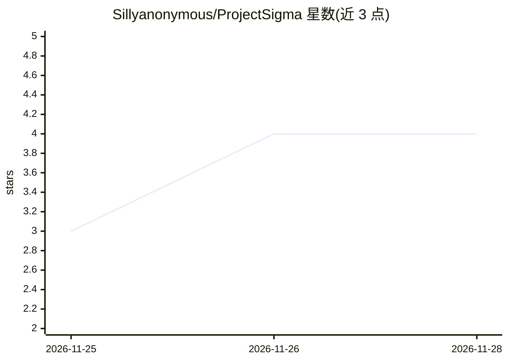

# Sillyanonymous/ProjectSigma

⭐ 4 · JavaScript · NOASSERTION · 推送 2026-11-25 · [GitHub](https://github.com/Sillyanonymous/ProjectSigma) · [官网](https://discord.gg/YpWrpqT4DF) · 个人维护

**自托管的 AI 角色卡库：百万级卡片管理、搜索、聊天与站点浏览**

以本地服务器形式运行的角色卡管理应用：将角色卡、聊天记录、lorebook、persona 与媒体存于同一 data/ 目录，支持百万级卡库的网格浏览、前缀搜索与 20+ 字段的过滤预设。聊天通过用户自配的 AI 连接完成，支持流式回复、分支、正则脚本与提示词检查器；另含扩展引擎（git URL/zip 安装）、HTTP API、SillyTavern 全库迁移向导与多用户账户。需 Node.js 22.15+，支持手机浏览器访问。

## 筛选速览

| 维度 | 判定 | 备注 |
|---|---|---|
| AI 角色 | `ai-native` | 本体是模型或模型工具 |
| 许可风险 | `none` | NOASSERTION |
| 部署形态 | `self-host` | docker 或自建部署 |
| 模型依赖 | — | README 未给出锁定关系 |
| 硬件要求 | — | 无带数字的原话,不猜 |
| 安装摩擦 | `low` | 无编译、无系统依赖或容器化 |
| 成熟度 | — | 结构信号不足 |

## 能力要点

- 面向百万级角色卡库的搜索与网格管理，含标签合并、去重、批量操作
- 任何 OpenAI 兼容端点即可聊天，Anthropic 经内置扩展接入，API key 仅存服务器
- 内置扩展引擎，可从 git URL 或 zip 安装，全部功能经文档化 HTTP API 暴露
- SillyTavern 全库迁移向导，逐字段校验且只读源目录

## 适用场景

- 在自有设备上集中管理大量角色卡、lorebook 与聊天记录
- 接入本地或托管的大模型端点与角色卡对话
- 从浏览器浏览多个角色卡站点并后台导入
- 多人共用一台服务器时按账户隔离各自的库

## 场景标签

`聊天机器人` · 领域:对话与助手

## 证据(README 行号)

> L41: - Your own AI connection. Any endpoint that speaks the OpenAI-compatible chat API, local
> L69: - An API underneath. Everything the app does goes through a documented HTTP API: power users can

## 星数曲线

2026-11-25 3 → 2026-11-28 4（+1）

---
*卡片 v1 · prompt 1.4 · 生成 2026-11-24 · 置信度 high · 依据 README sha `3fca5788fd30` · [字段定义](../../DATASET.md)*
