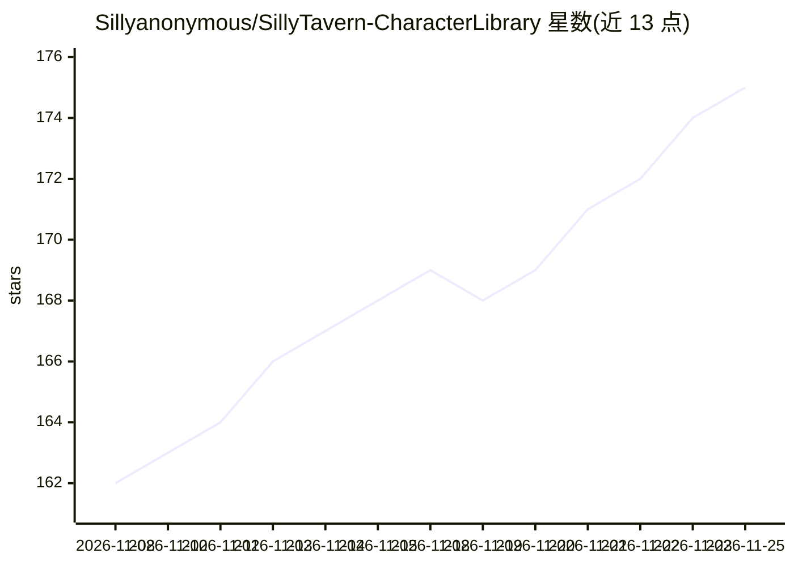

# Sillyanonymous/SillyTavern-CharacterLibrary

⭐ 175 · JavaScript · AGPL-3.0 · 推送 2026-11-20 · [GitHub](https://github.com/Sillyanonymous/SillyTavern-CharacterLibrary) · [官网](https://discord.gg/YpWrpqT4DF) · 个人维护

**SillyTavern 角色卡库管理扩展：发现、整理与管理角色库**

安装于 SillyTavern extensions 目录的第三方扩展，提供角色库网格浏览、搜索过滤排序、批量打标签/更新/导出、版本快照、播放列表与筛选预设，以及角色详情的标签页界面（编辑、聊天、媒体画廊、关联推荐）。支持 ChubAI 等在线角色站下载与图床媒体抓取。AI 部分为辅助功能：AI Studio 协助角色卡写作、AI 生成 Lorebook 条目与 CSS。README 声明开发暂停，等待独立版 Project Σ 发布。

## 筛选速览

| 维度 | 判定 | 备注 |
|---|---|---|
| AI 角色 | `ai-enhanced` | 去掉 AI 部分产品仍成立 |
| 许可风险 | `dual` | AGPL-3.0 |
| 部署形态 | `self-host` | docker 或自建部署 |
| 模型依赖 | — | README 未给出锁定关系 |
| 硬件要求 | — | 无带数字的原话,不猜 |
| 安装摩擦 | `low` | 无编译、无系统依赖或容器化 |
| 成熟度 | — | 结构信号不足 |

## 能力要点

- 角色库网格视图、三态标签过滤、批量操作与 Bundle 导入导出
- 版本快照与 diff 预览、播放列表、筛选预设
- AI Studio 协助角色卡字段创作与 Lorebook 条目生成
- ChubAI/Wyvern/Pygmalion 角色下载与多图床媒体抓取

## 适用场景

- 管理大量角色卡的整理、打标签与查找
- 从在线角色站浏览并下载角色到本地库
- 借助 AI Studio 辅助创作和迭代角色卡内容

## 场景标签

`AI 写作` · 领域:内容生成

## 证据(README 行号)

> L16: A powerful SillyTavern extension for discovering, organizing, and managing your character library with a modern gla
> L79: - **Character Creator** with built-in AI Studio for assisted card authoring, brainstorming, and iterative refinemen
> L81: - **Custom CSS theming** with snippet management and an AI CSS Assistant that writes and iterates on styling for yo

## 星数曲线

2026-11-08 162 → 2026-11-25 175（+13）

---
*卡片 v1 · prompt 1.4 · 生成 2026-11-17 · 置信度 mid · 依据 README sha `a7d82bc64dbd` · [字段定义](../../DATASET.md)*
