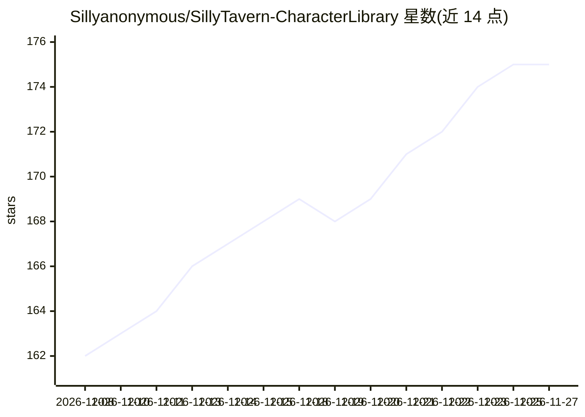

# Sillyanonymous/SillyTavern-CharacterLibrary

⭐ 175 · JavaScript · AGPL-3.0 · 推送 2026-11-20 · [GitHub](https://github.com/Sillyanonymous/SillyTavern-CharacterLibrary) · [官网](https://discord.gg/YpWrpqT4DF) · 个人维护

**SillyTavern 角色卡库管理扩展：发现、整理与批量管理角色卡**

作为 SillyTavern 扩展运行，提供角色卡的网格浏览（虚拟滚动/懒加载）、搜索过滤排序、标签三态筛选、收藏与播放列表组织；支持单选或批量打标、更新检查、导出导入（.zip 打包卡片/聊天/媒体/世界书）、版本快照与差异预览。内嵌 AI Studio 辅助逐字段撰写与迭代角色卡，AI CSS 助手生成样式；可从 ChubAI、Pygmalion 等站点浏览与下载角色，外部图床提取需 cl-helper 插件。安装方式为克隆到 SillyTavern 扩展目录后刷新页面。

## 筛选速览

| 维度 | 判定 | 备注 |
|---|---|---|
| AI 角色 | `ai-enhanced` | 去掉 AI 部分产品仍成立 |
| 许可风险 | `dual` | AGPL-3.0 |
| 部署形态 | `self-host` | docker 或自建部署 |
| 模型依赖 | — | README 未给出锁定关系 |
| 硬件要求 | — | 无带数字的原话,不猜 |
| 安装摩擦 | `low` | 无编译、无系统依赖或容器化 |
| 成熟度 | — | 结构信号不足 |

## 能力要点

- 网格视图、搜索过滤排序与批量打标/更新/导出导入等库管理能力
- AI Studio 逐字段多轮对话生成与迭代角色卡内容
- 版本历史快照、差异预览与 .zip 打包迁移
- 外部图床提取器支持 Civitai/Imgchest/Mega/Pixiv 等十余站点

## 适用场景

- 集中管理我在 SillyTavern 里的角色卡收藏与标签
- 从 ChubAI 等站点批量浏览并下载角色卡
- 用 AI Studio 辅助编写和打磨角色卡设定
- 在不同 SillyTavern 实例之间打包迁移角色库

## 场景标签

`聊天机器人` `AI 写作` · 领域:对话与助手

## 证据(README 行号)

> L16: A powerful SillyTavern extension for discovering, organizing, and managing your character library with a modern gla
> L79: - **Character Creator** with built-in AI Studio for assisted card authoring, brainstorming, and iterative refinemen
> L151: Create new characters from scratch or edit existing ones with an AI-powered assistant built into the library.

## 星数曲线

2026-11-08 162 → 2026-11-27 175（+13）

---
*卡片 v1 · prompt 1.4 · 生成 2026-11-26 · 置信度 low · 依据 README sha `68ababa60618` · [字段定义](../../DATASET.md)*
