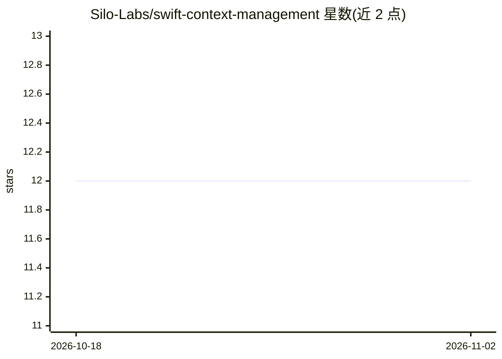

# Silo-Labs/swift-context-management

⭐ 12 · Swift · 推送 2026-02-06 · [GitHub](https://github.com/Silo-Labs/swift-context-management) · 组织维护

**Swift LLM 应用的上下文窗口管理库：裁剪/摘要/重构对话历史**

面向 Swift/macOS/iOS 开发者的上下文管理包，配合 FoundationModels 框架使用。提供多种上下文缩减策略：滑动窗口、头尾窗口、滚动摘要、分层摘要与结构化状态提取；当请求超出上下文窗口限制时自动以更激进的策略重试。流式响应与 @Generable 结构化输出同样具备重试缩减行为。另有若干策略（显著度裁剪、语义召回、主题记忆、dhRAG 等）列为待实现状态。

## 筛选速览

| 维度 | 判定 | 备注 |
|---|---|---|
| AI 角色 | `ai-ecosystem` | LLM/agent 周边工具 |
| 许可风险 | `none` | — |
| 部署形态 | `None` |  |
| 模型依赖 | — | README 未给出锁定关系 |
| 硬件要求 | — | 无带数字的原话,不猜 |
| 安装摩擦 | `low` | 无编译、无系统依赖或容器化 |
| 成熟度 | — | 结构信号不足 |

## 能力要点

- 上下文超限时自动重试并逐级加大缩减力度
- 5 种已实现缩减策略（滑动窗口/头尾窗口/滚动摘要/分层摘要/结构化状态）
- 流式 API 支持 @Generable 结构化输出的部分生成
- 与 FoundationModels 框架集成

## 适用场景

- 长对话超出 LLM token 限制时自动裁剪历史
- 在 iOS/macOS 应用中保留关键事实与决策的结构化状态
- 对 FoundationModels 会话做流式且不溢出的响应

## 场景标签

`Agent 记忆` · 领域:Agent 开发

## 证据(README 行号)

> L3: **Swift Context Management** is a Swift package designed to help developers manage language model context windows ef
> L10: - **Seamless Integration**: Built to work with the `FoundationModels` framework.

## 星数曲线

2026-10-18 12 → 2026-11-02 12（+0）

---
*卡片 v1 · prompt 1.4 · 生成 2026-11-01 · 置信度 high · 依据 README sha `3064deca0ea3` · [字段定义](../../DATASET.md)*
