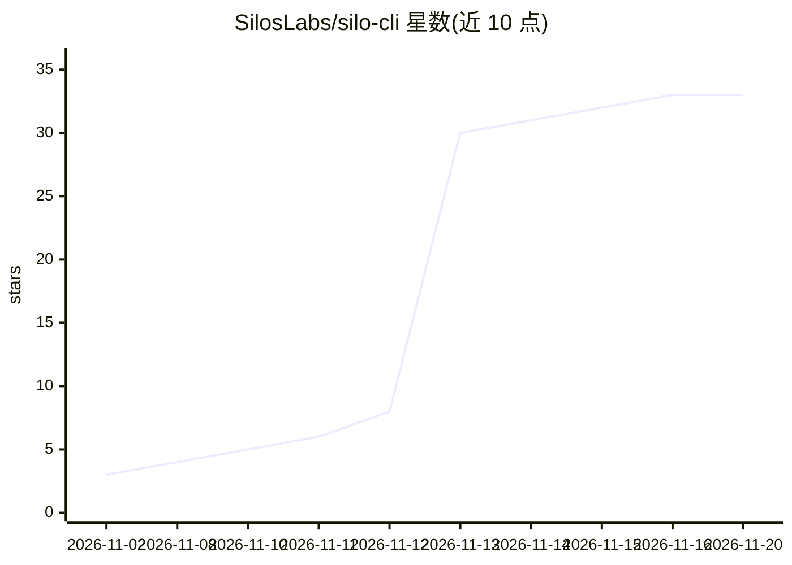

# SilosLabs/silo-cli

⭐ 33 · TypeScript · MIT · 推送 2026-11-19 · [GitHub](https://github.com/SilosLabs/silo-cli) · [官网](https://siloslabs.com/) · 组织维护

**在本地加固 Docker 沙箱中运行不可信 AI agent 的自托管 CLI**

面向开发者的 Node.js CLI 工具（TypeScript，MIT），用于在本地加固 Docker 容器中运行不受信任的 AI agent：容器以非 root、只读根文件系统、丢弃全部 Linux capabilities 运行，无直连互联网路由；主机侧透明推理代理拦截 LLM/egress 请求、注入 API 密钥（agent 不可见），YAML 策略引擎按规则放行或阻断出站请求，全部事件写入统一 JSONL 审计日志。内置 agent runner 编排工具调用循环，支持 OpenAI 与 Anthropic 函数调用格式，预置 CrewAI/LangGraph/Aider/SWE-Agent/OpenClaw 框架镜像，可通过 YAML 自定义框架，支持多 agent 并行。限制：尚未发布到 npm，需从源码安装；README 声明其降低但不消除风险。

## 筛选速览

| 维度 | 判定 | 备注 |
|---|---|---|
| AI 角色 | `ai-ecosystem` | LLM/agent 周边工具 |
| 许可风险 | `permissive` | MIT |
| 部署形态 | `library` | 以包/库形式分发 |
| 模型依赖 | — | README 未给出锁定关系 |
| 硬件要求 | — | 无带数字的原话,不猜 |
| 安装摩擦 | `low` | 无编译、无系统依赖或容器化 |
| 成熟度 | `idea` | |

## 能力要点

- 加固 Docker 沙箱：非 root、只读文件系统、cap-drop ALL、无 NAT 网关直连
- 透明推理代理在主机侧注入凭证，agent 永远看不到 API 密钥
- YAML 声明式 egress 策略引擎与统一 JSONL 审计日志（LLM 调用/工具/出站/阻断）
- 内置 agent runner + 5 种预置框架镜像（含浏览器模式 Chromium 沙箱）与多 agent 编排

## 适用场景

- 让有 shell 权限的 AI agent 在隔离沙箱里跑任务，防止密钥外泄与破坏性命令
- 对 agent 的 LLM 调用、工具执行与出站请求做统一审计与查询
- 用 OpenClaw 等框架在沙箱内做浏览器自动化而无需暴露主机
- 同时运行多个相互隔离的 agent，各自独立容器与工作区

## 场景标签

`Agent 框架` · 领域:Agent 开发

## 证据(README 行号)

> L5: **Self-hosted CLI for running untrusted AI agents locally inside hardened Docker sandboxes with controlled egress, c
> L20: * **Inference & Integration Proxy** (server.ts): Intercepts and logs LLM/egress requests, injects credentials on th
> L96: Run tasks directly from the CLI. SILO orchestrates the full LLM tool-calling loop — sending prompts, executing tool

## 星数曲线

2026-11-02 3 → 2026-11-20 33（+30）

---
*卡片 v1 · prompt 1.4 · 生成 2026-11-18 · 置信度 mid · 依据 README sha `34b09e6170f4` · [字段定义](../../DATASET.md)*
