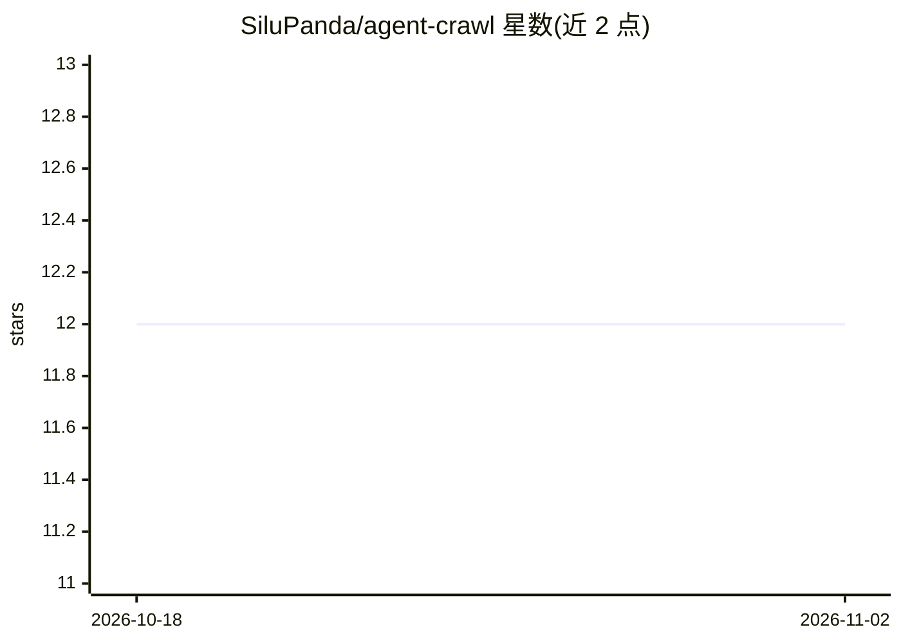

# SiluPanda/agent-crawl

⭐ 12 · TypeScript · MIT · 推送 2026-03-29 · [GitHub](https://github.com/SiluPanda/agent-crawl) · 个人维护

**面向 LLM agent 的 TypeScript 网页抓取库，输出干净 Markdown**

TypeScript 网页抓取与爬取库，定位为 LLM agent 的信息获取工具：抓取网页、去除广告/脚本/导航等噪声，返回面向 token 优化的 Markdown。核心是 Hybrid 引擎：默认静态抓取，遇到动态内容或认证时自动回退到 Playwright 无头浏览器。提供缓存、重试、UA 轮换、robots.txt 合规、sitemap 种子、可恢复爬取状态、token 感知分块（含引用锚点）与可选 stealth 模式。通过 npm/bun 安装，附 CLI 可直接在终端抓取与爬取。

## 筛选速览

| 维度 | 判定 | 备注 |
|---|---|---|
| AI 角色 | `ai-ecosystem` | LLM/agent 周边工具 |
| 许可风险 | `permissive` | MIT |
| 部署形态 | `library` | 以包/库形式分发 |
| 模型依赖 | — | README 未给出锁定关系 |
| 硬件要求 | — | 无带数字的原话,不猜 |
| 安装摩擦 | `low` | 无编译、无系统依赖或容器化 |
| 成熟度 | — | 结构信号不足 |

## 能力要点

- Hybrid 引擎：静态优先、动态内容自动回退无头浏览器
- 返回 token 优化的 Markdown，剥离 80-90% token
- token 感知分块并附带引用锚点，面向 RAG/agent 工具
- CLI 支持 CSS/正则结构化提取、多页爬取与 robots/sitemap 合规

## 适用场景

- 为 LLM agent 提供网页阅读（“眼睛”）能力
- 把网页转成干净 Markdown 喂入模型上下文
- 对站点做多页爬取并做 token 级分块用于 RAG

## 场景标签

`网页抓取` · 领域:效率与自动化

## 证据(README 行号)

> L5: **The High-Performance TypeScript Web Scraper for LLM Agents.**
> L7: AgentCrawl is built to be the "eyes" of your AI Agents. It fetches web content, strips away the noise (ads, scripts,
> L16: - 🔌 **Plug-and-Play**: Simple API designed for agent runtimes (scrape + crawl).

## 星数曲线

2026-10-18 12 → 2026-11-02 12（+0）

---
*卡片 v1 · prompt 1.4 · 生成 2026-11-01 · 置信度 high · 依据 README sha `a74f23128a79` · [字段定义](../../DATASET.md)*
