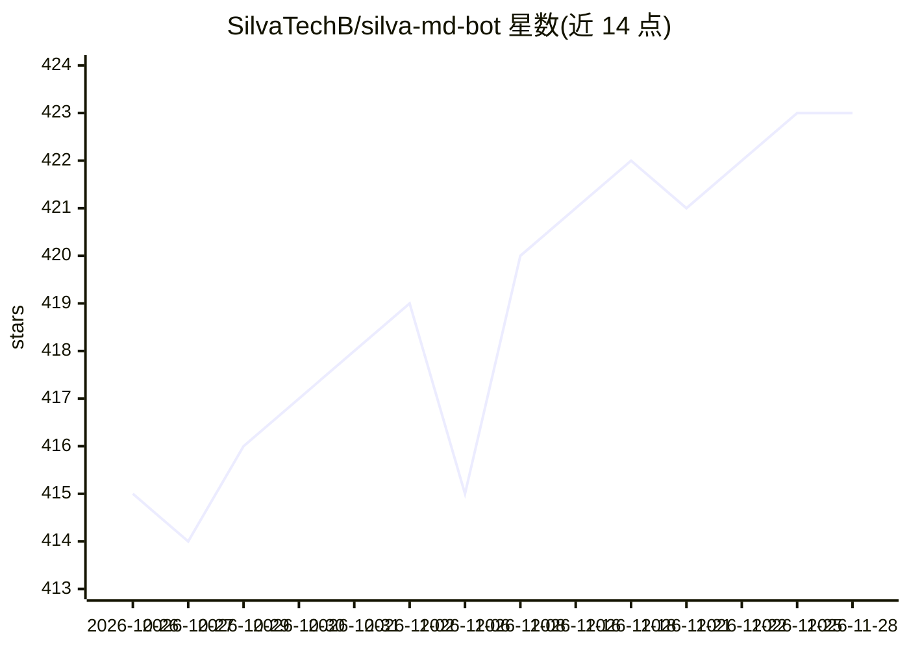

# SilvaTechB/silva-md-bot

⭐ 423 · JavaScript · MIT · 推送 2026-11-13 · [GitHub](https://github.com/SilvaTechB/silva-md-bot) · [官网](https://silva-session-selector.vercel.app/) · 组织维护

**WhatsApp 多设备机器人：自动交互、AI 助手与媒体下载**

面向 WhatsApp 个人与群组场景的多设备机器人，宣称提供 1,400+ 命令。通过 Session ID 绑定 WhatsApp 账号后部署到多种托管平台或本地 Node.js 环境运行。功能涵盖消息防护（反删除/反链接/防骚扰）、YouTube/TikTok/Instagram 等媒体下载、群组管理（成员/警告/投票）、游戏娱乐命令，以及基于 ch.at（无需 API key）或可选 OpenAI 兼容 API 的 Agent v2 助手，支持工具调用与持久聊天记忆。可选 Postgres 加密存储会话数据。

## 筛选速览

| 维度 | 判定 | 备注 |
|---|---|---|
| AI 角色 | `ai-enhanced` | 去掉 AI 部分产品仍成立 |
| 许可风险 | `permissive` | MIT |
| 部署形态 | `library` | 以包/库形式分发 |
| 模型依赖 | — | README 未给出锁定关系 |
| 硬件要求 | — | 无带数字的原话,不猜 |
| 安装摩擦 | `low` | 无编译、无系统依赖或容器化 |
| 成熟度 | — | 结构信号不足 |

## 能力要点

- Agent v2 助手：工具调用、持久记忆、网络查询，默认经 ch.at 无需 API key
- 1,400+ 命令覆盖媒体下载、群组管理、防护与游戏
- 支持 Heroku/Railway/Koyeb/Replit 等多平台一键部署与 PM2 常驻
- 可选 AES-256-GCM 加密的 Postgres 存储

## 适用场景

- 在 WhatsApp 中用命令下载各平台视频与音频
- 群主自动管理成员、警告与入群审批
- 通过对话式 AI 助手完成计算、天气与记忆备忘
- 自动防删消息恢复与群防骚扰

## 场景标签

`聊天机器人` `AI 助手` · 领域:对话与助手

## 证据(README 行号)

> L5: > **A powerful multi-device WhatsApp bot — 1,400+ commands, AI agent, 19 smart features, anti-ban protection.**
> L121: Agent v2 is the primary Silva assistant backed by ch.at and does not require an API key. It can use approved tools
> L88: **Requirements:** Node.js 20+ · Git

## 星数曲线

2026-10-26 415 → 2026-11-28 423（+8）

---
*卡片 v1 · prompt 1.4 · 生成 2026-11-25 · 置信度 high · 依据 README sha `ee6114389b18` · [字段定义](../../DATASET.md)*
